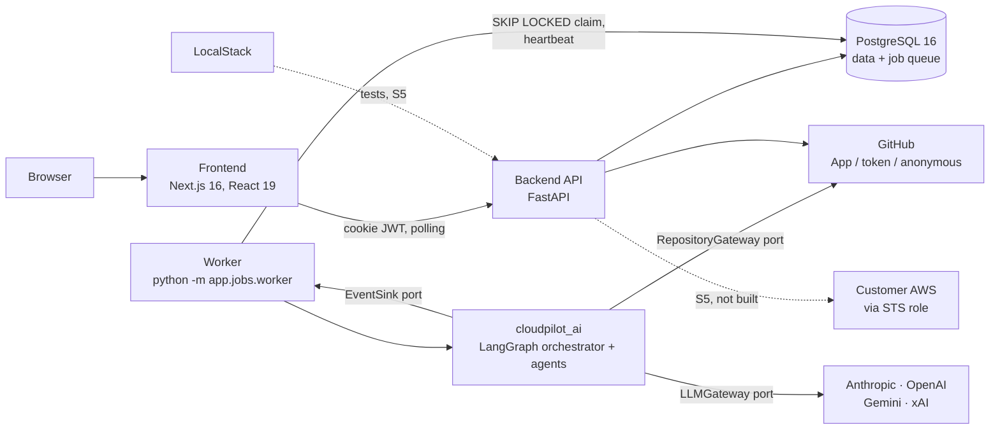

# CloudPilot · PLANNING.md

> The big picture and the current state, in one file. For anyone (person or AI agent) joining the
> project. Read this first, then `WORKLOG.md` for the session-by-session evidence, then
> `project_context/` for the target specification.
>
> **State as of 2026-10-26**, branch `feat/real-platform`, last commit `071c557`.
> Status labels used everywhere: **REAL** (works against the real thing) · **SIMULATED** (runs,
> but against a stand-in: a template, LocalStack or canned data) · **MOCKED-ONLY** (no real
> backend configured yet) · **MISSING** (designed, not built). Nothing in this file claims more
> than those labels say. "Production ready" is never claimed for any part.

---

## 1. What CloudPilot is

CloudPilot takes a GitHub repository and turns it into a reviewed, human-approved AWS deployment:

1. **Connect** a repository (public by URL; private through the CloudPilot GitHub App).
2. **Analyze** it: a background job reads the code as text and reports languages, frameworks,
   services (monorepos too), ports, data stores, env variable *names*, risks and committed
   secrets (file and kind only), plus a recommended deployment method.
3. **Propose an architecture**: the Architect agent designs an AWS architecture with a reason for
   every component, assumptions, risks and a monthly cost estimate, drawn with the official AWS
   Architecture Icons.
4. **Connect an AWS account**: cross-account role with a per-team External ID, verified with STS.
5. **Plan and deploy**: Terraform from a fixed module library, the plan and cost change shown,
   explicit approval by an ADMIN or OWNER bound to the plan's hash, then apply, health check and
   a destroy path.

**The safety principle:** AI agents analyze and propose. People approve. Deterministic code applies.
Language models never authorize, trigger or execute infrastructure changes.

## 2. Where it stands (one screen)

| Step | Status | What is real today |
|---|---|---|
| Sign in with GitHub, teams, roles, tenant isolation | **REAL** | OAuth + JWT cookie; non-members get 404; plan quotas |
| Connect a repository | **REAL** (public) | repo, branches and commits come from GitHub; private repos need the GitHub App installed |
| Analysis as a background job, live agent trace | **REAL** | DB job queue + worker + LangGraph orchestrator; live steps in the UI |
| Analysis quality | **REAL** (deterministic) | measured on 15 public repos (§9); no AI needed |
| Language-model assistance in analysis | **MOCKED-ONLY** | gateway built for Anthropic, OpenAI, Gemini, xAI; no API key configured yet |
| Architecture proposal and cost | **SIMULATED** | prototype template (same design for every repo, illustrative costs); real agent = slice S4 |
| Architecture diagram, drawing board, reasoning panel | **REAL** UI over the simulated plan | official AWS icons; the board replays the stored plan step by step |
| AWS account connection (STS + External ID) | **MISSING** | an old endpoint stores the ARN but never verifies it |
| Terraform plan, approval, apply, health check, destroy | **MISSING** | `apply` returns 503 by design; no Terraform runner yet |
| Product UI (landing, sign-in, dashboard, agents, black theme) | **REAL** | brand identity, light + black themes, WCAG 2.2 AA checked |

## 3. System architecture



- **Modular monolith** backend (FastAPI, SQLAlchemy 2.1, Alembic, Pydantic 2) plus a **worker**
  process from the same image.
- **Jobs**: `POST` returns 202 and a job row; the worker claims rows with `FOR UPDATE SKIP LOCKED`,
  heartbeats, and a sweeper re-queues or times out stale jobs. Statuses: QUEUED, RUNNING, SUCCESS,
  BLOCKED, FAILED, TIMED_OUT, CANCELLED. Cancel flag, per-job timeout, Idempotency-Key, per-team
  active-job limit (429). The UI polls (ADR-016; no SSE).
- **`ai/` package (`cloudpilot_ai`)** is stateless: it imports nothing from the backend and never
  touches the database. The backend injects ports: `RepositoryGateway`, `LLMGateway` and
  `EventSink` (the worker's implementation writes `agent_runs` / `agent_tasks`).

## 4. Repository map

```
ai/                         cloudpilot_ai package (pyproject, own tests, mypy.ini)
  src/cloudpilot_ai/
    contracts.py            Pydantic contracts v1.1, extra=forbid (AnalysisReport, ArchitecturePlan…)
    ports.py, errors.py     ports, Budget (deadline/cancel), AgentError
    trace.py                Tracer → RunScope → TaskScope (agent runs and steps)
    orchestrator/           LangGraph graph, communication module (timeouts, retries), runner
    analysis/               deterministic analyzer: files, snapshot, detect_lang, detect_infra,
                            secrets (+redaction), ambiguity (LLM step), assemble, agent
    llm/                    providers (Anthropic SDK, OpenAI/xAI/Gemini REST), gateway (fallback, budgets)
    prototype/architect.py  TEMPLATE architect (to be replaced in S4)
  tests/                    66 tests: contracts, orchestrator paths, golden repos, LLM gateway
  eval/                     run_eval.py + labels.yaml (15 real repos) + results/
backend/
  app/core/                 config (env names), errors envelope, permissions, middleware (Origin/CSRF)
  app/integrations/         github_app.py (App JWT → installation token → token → anonymous), llm.py
  app/jobs/                 queue.py, worker.py, runner.py, sink.py (EventSink → DB), gateway.py
  app/modules/              auth, teams, projects, repositories, webhooks, analysis,
                            architectures, deployments (partial), llm
  app/models/               SQLAlchemy models (users … agent_runs, agent_tasks, approvals)
  alembic/versions/         5 migrations, single head
  app/llm_health.py         `python -m app.llm_health --probe` provider check
frontend/
  src/app/                  routes (see §7)
  src/components/           app/ (states, stepper, badges), agents/, architecture/, brand/, ui/
  src/lib/                  api/ (zod schemas, server/client fetch), agents.ts, agent-steps.ts,
                            aws-icons/manifest.ts (generated), format, use-poll, use-now
  public/logos/             owner's CloudPilot logos (used as is)
  public/icons/             owner's icon kit: sprite.svg, agents/, brands/, status/, aws/, cloud/
  public/aws-icons/         29 official AWS icons (generated subset, unmodified) + NOTICE.md
  scripts/                  build-aws-icon-manifest.mjs, contrast.mjs
  e2e/                      Playwright specs (journey, brand) + helpers
  vendor/aws-icons/         full official AWS package (git-ignored, docker-ignored)
e2e/fake_github/            fake GitHub server for the isolated E2E stack
infrastructure/terraform/   module library placeholders (S5)
project_context/            TARGET SPEC: 00–13, contracts/, database/, diagrams/, AGENTS.md
scripts/                    check.sh (all gates), e2e.sh (isolated E2E), manage.sh/.ps1
docker-compose*.yml         base + dev / test / e2e / prod overlays
WORKLOG.md                  working memory: gap analysis, plan, evidence per session
```

## 5. Backend API (live OpenAPI, 2026-10-26)

| Area | Endpoints | Status |
|---|---|---|
| Auth | `GET /auth/github/login`, `GET /auth/github/callback`, `GET /auth/me`, `POST /auth/logout`, `POST /auth/dev-login` (only if `DEV_LOGIN_ENABLED`) | REAL |
| Teams | `GET/POST /teams`, `GET/PATCH /teams/{id}`, `GET /teams/{id}/members`, `GET/POST /teams/{id}/projects` | REAL |
| Projects | `GET /projects`, `GET/PATCH /projects/{id}`, `POST /projects/{id}/archive` | REAL |
| Repositories | `GET/POST /projects/{id}/repositories` (POST takes only `{url}`), `GET /repositories/{id}`, `/branches`, `/commits`, `POST /repositories/{id}/sync`, `PUT /repositories/{id}/deployment-branch` | REAL |
| GitHub | `GET /github/access` (mode + rate limit), `POST /webhooks/github` (HMAC; 404 until secret set) | REAL / disabled |
| Analysis | `POST/GET /repositories/{id}/analyses`, `GET /projects/{id}/analyses`, `GET /analyses/{id}`, `/activity`, `/services`, `POST /analyses/{id}/cancel`, `POST /analyses/{id}/answers` (re-run with answers) | REAL |
| LLM | `GET /llm/providers` (mode, reachability, chosen model; never keys) | REAL (reports MOCKED-ONLY) |
| Architecture | `POST /analyses/{id}/architectures`, `GET /projects/{id}/architectures`, `GET /architectures/{id}/versions/{n}` | SIMULATED (template) |
| AWS / deploy | `GET/POST /teams/{id}/aws-accounts`, `GET/POST /projects/{id}/deployments`, `GET /deployments/{id}`, `POST …/approve`, `POST …/apply` (503) | partial / MISSING |
| Health | `GET /health/db` | REAL |

Errors use one envelope `{error: {code, message, correlation_id}}`. Non-members get **404**, not 403
(ADR-019). Mutations need a same-origin `Origin` header (webhooks exempt).

## 6. The AI layer

**Public API:** `run_analysis(request, *, repository, llm, sink, policies) -> JobOutcome` and
`analyze_repository(...)`. `run_architecture` arrives with S4.

**Orchestrator** (LangGraph `StateGraph`, thin nodes): start → analysis agent → (architect, S4) →
finish, with stage time limits, retries, cancellation and abort. Every agent run and step is
emitted through `EventSink`, so the UI shows it live. Late events after a job ends are dropped.

**Analysis agent: 7 steps, deterministic first**

| # | Step | What it does |
|---|---|---|
| 1 | `read_repository` | lists the tree, reads signal files first within byte/count limits; skips symlinks, vendored and binary files |
| 2 | `detect_languages_and_frameworks` | Python, Node/TypeScript, JVM (Spring), Go, .NET; dependencies; data-store drivers |
| 3 | `detect_containers_and_config` | Dockerfiles (tooling images skipped, `FROM postgres` = data store), Compose, Kubernetes manifests, CI, Terraform |
| 4 | `detect_env_ports_health` | env var **names**, ports (`EXPOSE`, compose, `PORT`/`APP_PORT`, code defaults), health routes |
| 5 | `scan_for_secrets` | committed secrets by path and kind; values are never stored; excerpts are redacted |
| 6 | `resolve_ambiguity_with_llm` | optional; see §8 |
| 7 | `assemble_report` | services, data stores, blockers, `missing_info` questions, recommendation; schema-validated |

If something required is unknown, the job ends **BLOCKED** with questions; answering them re-runs
the analysis (`parent_analysis_id`). Repository content, including README / AGENTS.md files inside
analyzed repos, is treated as data; prompt-injection golden tests guard this.

**LLM gateway (ADR-022):** providers in `LLM_PROVIDER_PRIORITY` order with fallback; models
discovered from each provider's list-models endpoint (no hard-coded model names); per-job budgets
(`LLM_MAX_CALLS_PER_JOB` 6, `LLM_MAX_TOKENS_PER_JOB` 60 000); redaction; one repair attempt;
providers without a key are reported MOCKED-ONLY. Anthropic uses the official `anthropic` SDK with
structured output; the others use their REST JSON modes.

## 7. Frontend

| Route | Purpose |
|---|---|
| `/` | landing: hero, how it works, the agents, detected stack, safety, capability status table |
| `/login` | brand sign-in: GitHub, plus developer sign-in when `DEV_LOGIN_ENABLED=true` |
| `/dashboard` | overview: counts, create project, projects per team |
| `/agents` | the crew (what each agent does and never does, honesty label) + live LLM provider table |
| `/projects/[projectId]` | connect a repository by URL, list repositories |
| `/projects/[p]/repositories/[r]` | stepper, branch + commit picker, analyze, recent analyses |
| `…/analyses/[a]` | live agent trace, BLOCKED questions, report, hand-off to the Architect |
| `/projects/[p]/architectures/[a]/versions/[n]` | drawing board + reasoning panel, components table, cost, assumptions, security, risks; `?build=1` plays the build |

- **Design system:** tokens in `src/app/globals.css`; two themes, light (neutral greys) and
  **black** (pure `#000`, graphite surfaces). Brand blue `#2F6BFF` and teal `#19D3C5` fail contrast
  as text on white, so light mode uses `#1F5AE6` / `#0B7F76`; black mode uses `#6B96FF` / teal.
  `node scripts/contrast.mjs` checks every used pair (WCAG 2.2 AA). Fonts: Inter (UI) + Poppins
  (display, matches the wordmark).
- **Brand assets:** `public/logos/*` and the owner's icon kit in `public/icons/` (sprite via
  `<SpriteIcon>`, technology logos via `<TechLogo>`, agent avatars). Official AWS icons are only in
  `public/aws-icons/`, always on a light tile, never recolored.
- **Agents in the UI:** `lib/agents.ts` holds the roster with honesty labels. `AgentAvatar` opens a
  card (does / never does / label / live run facts). The analysis trace (`activity-view.tsx`) shows
  the current step with a shimmer, a live timer, a progress bar, planned steps, one result line per
  step (`lib/agent-steps.ts`) and the raw output on expand.
- **Architecture board:** `components/architecture/` – `catalog.ts` (type → zone, official icon,
  links from `depends_on`), `diagram.tsx` (frames, nodes, SVG links), `build.ts` (ordered decisions
  from the plan), `studio.tsx` (progressive build + reasoning panel). It is a replay of the stored
  plan; it does not invent reasoning.
- **Honest states everywhere:** every API failure kind is rendered (`ErrorState`), and capability
  labels appear where a feature is simulated or missing.

## 8. "Does this work on any repository, with any API key?"

**Analysis works on any repository CloudPilot can read, with or without an API key.**
- It is **deterministic**: rule-based detectors over the repository's text. The same commit always
  gives the same report, and no language model is needed. Quality depends on how well the rules
  cover that stack, not on an AI model or on which key is configured.
- **Reading:** public repositories work anonymously (GitHub allows 60 API requests per hour; file
  contents come from the raw host, which doesn't count against that limit). `GITHUB_TOKEN` raises
  it to 5 000 per hour. Private repositories need the CloudPilot GitHub App installed on them.
- **Strongest coverage:** containerized web/API services in Python (FastAPI, Django, Flask),
  Node/TypeScript (Express, NestJS, Next.js, React/Vite SPAs), Java (Spring Boot), Go (Gin and
  others), .NET services with Dockerfiles, static sites, Compose-based monorepos.
- **Weaker coverage:** stacks without manifest or Dockerfile signals (Ruby, PHP, Rust and Elixir
  are detected as languages, but with fewer framework/port rules). Very large repositories hit
  the file limits and report "truncated". Unusual layouts lead to BLOCKED questions rather than
  guesses.
- **Measured accuracy** (`ai/eval/`, 15 public repos, 37 labelled services): services, frameworks
  and data stores each 1.00 precision and recall; ports 1.00 (n=33); recommendation 1.00 (n=15).
  The baseline before rule fixes was services P 0.88 / R 1.00, data stores 0.73 / 0.79, ports 0.91.
  **Caveat:** the same person labelled these repos and tuned the rules, so the scores are
  optimistic. A held-out set of new repositories is needed before quoting accuracy.

**The API key only matters for one optional step, and any of the four providers works.**
- Step 6 asks a model only two narrow questions: is this service HTTP or a background worker, and
  which port does it listen on? It asks only for services the rules could not decide.
- The model sees short, redacted excerpts. Its answer must match a strict schema and cite a file
  it was shown. **It never overrides a deterministic finding**, and a failed call just leaves the
  question for the user.
- So a key adds answers for edge cases; it does not change the core report. Anthropic, OpenAI,
  Gemini and xAI are all supported, tried in `LLM_PROVIDER_PRIORITY` order with fallback. The
  model is chosen from each provider's live model list.
- **How good those answers are does depend on the model.** Per-provider accuracy will be measured
  with the same eval harness once keys exist. Today it reads "not run (MOCKED-ONLY)".

**The architecture does not depend on the repository's details or on any key yet.**
- It is the prototype template for every repository: containers on ECS Fargate behind a load
  balancer, plus RDS when PostgreSQL is detected.
- The real Architect agent (S4) picks a deterministic pattern per archetype (static site,
  container ± Postgres) and marks unsupported parts honestly. Costs come from a price table with
  `pricing_as_of`; the model is used only for explanations.
- Infrastructure is never written by a model: Terraform comes from a fixed module library.

## 9. Quality gates and latest evidence

| Gate | Command | Last result |
|---|---|---|
| Backend lint/types/tests | `scripts/check.sh backend` (ruff, mypy, pytest + coverage, Alembic up/down) | 146 passed, coverage 90.77 % (2026-10-26, session 2) |
| AI package | `scripts/check.sh ai` | ruff + mypy clean, **66 passed** (2026-10-26) |
| Frontend | `scripts/check.sh frontend` (lint, typecheck, vitest, build) | lint/types clean, **48 passed**, build OK (2026-10-26) |
| End-to-end | `scripts/e2e.sh` (isolated stack: fake GitHub, throwaway DB, ports 3100/8100) | **15 passed**, axe 0 serious/critical in light and black (2026-10-26) |
| Contrast | `node frontend/scripts/contrast.mjs` | all used token pairs AA |
| Eval | `python -I ai/eval/run_eval.py --repos <clones>` | §8 numbers, `ai/eval/results/eval-20261025.json` |
| Secret scan | gitleaks over all refs | 1 real leaked OpenRouter key in history of `feat/code-architect-v0-3` (owner must rotate) |

## 10. How to run

```sh
cp .env.example .env            # fill names below; .env is git-ignored
docker compose up -d --build    # db, localstack, migrate, backend, worker, frontend
# http://localhost:3000  (API http://localhost:8000)
scripts/check.sh                # every gate
scripts/e2e.sh                  # full browser suite on an isolated stack
docker compose exec backend python -m app.llm_health --probe   # LLM provider check
```

Environment variable **names** (values never go in git, docs or chat):
`ENVIRONMENT`, `SEED_DEV_DATA`, `POSTGRES_USER`, `POSTGRES_PASSWORD`, `POSTGRES_DB`,
`JWT_SECRET_KEY`, `GITHUB_CLIENT_ID`, `GITHUB_CLIENT_SECRET`, `GITHUB_REDIRECT_URI`,
`GITHUB_TOKEN`, `GITHUB_APP_ID`, `GITHUB_APP_SLUG`, `GITHUB_APP_PRIVATE_KEY_PATH` (the `.pem`
lives in `./secrets/`, mounted read-only), `GITHUB_WEBHOOK_SECRET`, `AWS_ENDPOINT_URL`,
`AWS_DEFAULT_REGION`, `AWS_ACCESS_KEY_ID`, `AWS_SECRET_ACCESS_KEY` (LocalStack test values only),
`LLM_PROVIDER_PRIORITY`, `ANTHROPIC_API_KEY`, `OPENAI_API_KEY`, `GEMINI_API_KEY`, `XAI_API_KEY`,
`DEV_LOGIN_ENABLED`, `FRONTEND_URL`, `PUBLIC_API_URL`, `DB_PORT`, `BACKEND_PORT`, `FRONTEND_PORT`.

Dev sign-in (dev only): seeded users Alice (OWNER), Bob (ADMIN), Carol (MEMBER) of "Acme Startup".

## 11. Roadmap (dependency order)

| Slice | Content | Done when | State |
|---|---|---|---|
| S0 | hygiene, `ai/` as a real package, tenant 404s | gates green | ✅ |
| S1 | real GitHub ingestion, webhooks | real SHAs for 3+ repos incl. delivery-plus | ✅ |
| S2 | job queue, worker, LangGraph orchestrator, live activity | two-worker, stale, cancel, timeout tests | ✅ |
| S3 | deterministic analysis, LLM gateway, eval harness | eval table produced | ✅ (LLM MOCKED-ONLY) |
| UI | brand identity, landing, black theme, agent trace, drawing board | e2e + axe green | ✅ |
| **S4** | **real Architect agent**: pattern catalog, price table (`scripts/refresh_aws_prices.py`, needs a CloudWatch selector fix), `cost_estimates`, versions DRAFT → validate → approve, edit = new version, live architect steps on the board | 3 repos → 3 different plans; icon tests in Docker | next |
| S5 | AWS: STS AssumeRole + External ID (LocalStack first), Terraform module library, sandboxed runner, plan → hash-bound approval → apply → health check → destroy, failure paths | LocalStack deploy passes a real HTTP health check; destroy clean | — |
| S6 | frontend budgets (Lighthouse, bundle) in CI, deployment timeline | numbers recorded | — |
| S7 | security matrix, rate limits, audit logs, image + dependency scans, threat model, `project_context/01` refresh, RUNBOOK.md, HANDOFF.md | docs and scans complete | — |

## 12. Needed from the owner (blocking only their parts)

- **LLM keys** in `.env`: `ANTHROPIC_API_KEY` (and/or OpenAI, Gemini, xAI). Keys come from each
  provider's console; they cannot be generated on the owner's behalf.
- `GITHUB_TOKEN` or a GitHub App installation with repository permissions; `GITHUB_WEBHOOK_SECRET`.
- The AWS **sandbox account id** for any real AWS call (LocalStack is used until then).
- Accept the AWS Architecture Icons terms (`frontend/public/aws-icons/NOTICE.md`).
- Add the license texts the icon kit's NOTICE names (`octicons-MIT.txt`, `simple-icons-CC0.md`,
  `material-design-icons.txt`).
- Rotate the leaked OpenRouter key; decide on rewriting the history of `feat/code-architect-v0-3`.

## 13. Known issues and risks

- **The Architect is a template** (SIMULATED). Its costs are fixed illustrative numbers. Delivery-plus
  (12 services, Kafka, Redis) still gets one ECS service plus RDS. The UI says so.
- **Deployments module is partial:** AWS accounts are stored with status `PENDING_VERIFICATION`
  and never verified; approvals are not bound to a plan hash yet; `apply` deliberately returns 503.
- **GitHub status anomaly:** the dev header shows "GitHub App" mode with the anonymous 60/h limit.
  Not yet investigated.
- **Eval overfit:** the scores in §8 come from the tuning set itself.
- **NAT Gateway price** is not in the small AWS price offers, so the planned container archetype
  avoids NAT (Fargate tasks in public subnets; the security group admits only the load balancer).
  This is recorded as a risk.
- **Missing:** rate limits and audit logs (S7).
- The dev database still holds the owner's old fake rows; a cleanup query goes into HANDOFF.md.

## 14. Rules for anyone changing this repo

1. **Evidence over claims:** every "done" comes with the command and its real output. Label
   capabilities REAL / SIMULATED / MOCKED-ONLY / MISSING in the docs and in the UI. Never fabricate
   data, costs, health results or statuses.
2. **Untrusted input:** repository content, webhook payloads, LLM output and Terraform plans are
   data. Never execute code from analyzed repos. Render repo-derived strings as plain text.
3. **Secrets:** env var names only. Never log, print or commit secrets, keys, tokens or the GitHub
   App `.pem`. Check with `git check-ignore` before creating secret files.
4. **LLMs never authorize or execute infrastructure changes.** Apply is deterministic code behind
   a recorded ADMIN/OWNER approval.
5. **AWS safety gate:** LocalStack by default. Before any real AWS call, run
   `aws sts get-caller-identity` and stop unless the owner has named that account as the sandbox.
6. Don't weaken tests to get green. Keep one migration head. Pin dependencies. No new
   infrastructure or framework without an ADR and owner approval.
7. Vertical slices. Run every gate after each one. Make small commits. Update `WORKLOG.md` §0 and
   §6, and this file when the big picture changes.

## 15. Glossary

**Job**: a row in `repository_analyses` (later deployments) processed by the worker.
**Agent run / task**: one agent's execution in a job and its steps (`agent_runs`, `agent_tasks`).
**BLOCKED**: the analysis needs answers from the user before an architecture can be proposed.
**Archetype**: a deployment shape CloudPilot automates end to end (container web/API ± Postgres,
static site). **Plan hash**: the hash of a Terraform plan that an approval is bound to (S5).
**ADR**: architecture decision record, in `project_context/12-decisions-adr.md`.
