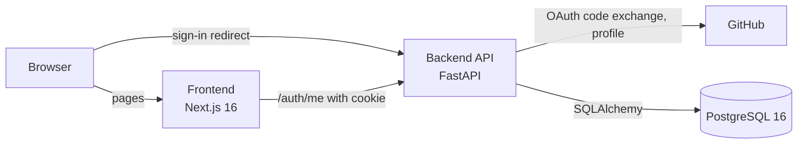
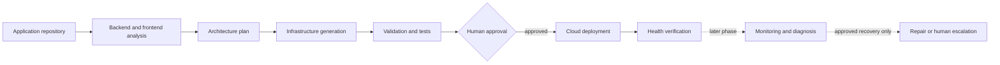

<p align="center">
  <picture>
    <source media="(prefers-color-scheme: dark)" srcset="assets/logo-full-on-dark.svg">
    <source media="(prefers-color-scheme: light)" srcset="assets/logo-full-on-light.svg">
    
  </picture>
</p>

<p align="center">
  
  
  
  
  
  
  
  
</p>

<p align="center">
  <strong>Plan and deploy cloud infrastructure for your application, with a human in control.</strong><br>
  A private project exploring AI-assisted AWS architecture and deployment.
</p>

<p align="center">
  <a href="https://github.com/cloudcopolit/ai-cloud-deployment-platform/actions/workflows/backend.yml"></a>
  <a href="https://github.com/cloudcopolit/ai-cloud-deployment-platform/actions/workflows/frontend.yml"></a>
  <a href="https://github.com/cloudcopolit/ai-cloud-deployment-platform/actions/workflows/ai.yml"></a>
  <a href="https://github.com/cloudcopolit/ai-cloud-deployment-platform/actions/workflows/infrastructure.yml"></a>
  <a href="https://github.com/cloudcopolit/ai-cloud-deployment-platform/actions/workflows/security.yml"></a>
  <a href="https://github.com/cloudcopolit/ai-cloud-deployment-platform/actions/workflows/repository.yml"></a>
</p>

<p align="center">
  <a href="#project-status">Status</a> &middot;
  <a href="#architecture">Architecture</a> &middot;
  <a href="#repository-structure">Structure</a> &middot;
  <a href="#local-development">Local development</a> &middot;
  <a href="#quality-checks">Quality checks</a> &middot;
  <a href="#continuous-integration">CI</a> &middot;
  <a href="#known-limitations">Limitations</a>
</p>

---

> **Private project:** This repository is for authorized project collaborators; it is not a public open-source project.
> **Current status:** early development. GitHub sign-in, a protected dashboard shell, and the first database tables work locally. The AI agents, infrastructure generation, and cloud deployment are **planned, not implemented**. This README marks each part as one or the other.

## Project status

| Area | Current state |
|---|---|
| Backend API (`backend/`) | **Implemented:** FastAPI app, PostgreSQL schema for users, teams, plans, subscriptions, projects, repositories, branches and commits (Alembic migrations), idempotent seed script, GitHub OAuth sign-in, JWT in an HttpOnly cookie, CORS, development-only login. **Placeholder:** `analysis`, `deployments`, `projects`, `repositories` modules are empty. |
| Frontend (`frontend/`) | **Implemented:** Next.js 16 app with login page, route protection (`src/proxy.ts`), server-side session lookup, and a protected dashboard layout with logout. **Planned:** projects, repository connection, architecture editor, deployment history. |
| AI layer (`ai/`) | **Placeholder.** Agent, prompt, tool, and workflow directories are empty on `main`. A Code Architect prototype is in progress on a feature branch. See [ai/README.md](ai/README.md). |
| Infrastructure (`infrastructure/`) | **Placeholder.** Terraform module and environment directories contain no configuration. The root `docker-compose.yml` is empty; the backend's local database is defined in [`backend/db.yml`](backend/db.yml). |
| Tests | Backend: pytest suite (auth, OAuth client, CORS, seed, migrations) against PostgreSQL with a 90% coverage gate. Frontend: Vitest unit tests for route protection and API schemas. |
| CI | GitHub Actions quality gates for every component, security scans, and workflow linting. See [Continuous integration](#continuous-integration). |

## Vision

CloudPilot aims to help a developer take an existing application from source code to a reviewed cloud deployment:

1. Analyze the application and identify its runtime, dependencies, ports, and health checks.
2. Propose an AWS architecture and generate infrastructure code.
3. Let the user inspect and edit the plan.
4. Validate the application and infrastructure before deployment.
5. Deploy only after explicit approval, then verify the result.
6. In a later phase, monitor the deployment and suggest safe, approved recovery actions.

**Safety principle:** AI can propose actions; validation rules, human approval, and cloud permissions must control what actually runs.

## Architecture

### What runs today



- The **frontend** protects `/dashboard`, `/projects`, `/settings`, and `/team` in `src/proxy.ts` and loads the signed-in user server-side from `GET /auth/me`.
- The **backend** runs the GitHub OAuth flow, creates or updates the user, and issues a short-lived JWT in an HttpOnly cookie. Team roles will be checked from the database on each request, not stored in the token.
- Details: [backend/README.md](backend/README.md) and [frontend/README.md](frontend/README.md).

### Planned flow

The diagram shows the intended product flow. It is a design sketch; none of the AI, generation, or deployment steps exist yet.



### Components and responsibilities

| Component | Responsibility | Status |
|---|---|---|
| Frontend | Sign-in, protected dashboard; later the chat-based workflow and architecture editor | Partially implemented |
| Backend API | Identity, teams, subscriptions, projects, source-control records; later analysis, architecture versions, deployments | Partially implemented |
| Orchestrator (`ai/agents/orchestrator`) | Coordinate analysis, planning, validation, approval, and deployment across agents | Planned |
| Code analyzer agent | Identify how an application is built and run | Planned |
| Architecture agent | Produce a cloud resource plan | Planned |
| Terraform agent | Generate infrastructure-as-code | Planned |
| Validator agent | Check generated plans and application behavior | Planned |
| Prompts, tools, workflows (`ai/`) | Prompt templates, tools agents may call, and workflow definitions used by the orchestrator | Planned |
| Infrastructure (`infrastructure/terraform`) | Reusable modules (VPC, compute, load balancer, security group) and per-environment configuration | Planned |
| Monitoring and recovery | Diagnose issues and propose controlled repairs | Later-phase concept |

**How the AI parts are meant to fit together:** the backend will hand an analysis or planning request to the orchestrator; the orchestrator calls specialized agents, which use prompts from `ai/prompts/` and act only through tools in `ai/tools/`; multi-step sequences are described in `ai/workflows/`. Agent output is treated as untrusted and must pass validation and human approval before anything is deployed. CI already discovers and checks any AI project added under `ai/`; see [ai/README.md](ai/README.md) for the conventions.

### Planned technology direction

These technologies are part of the project plan, not current integrations:

| Area | Planned direction |
|---|---|
| AI integrations | Amazon Bedrock, Model Context Protocol (MCP), retrieval-augmented generation |
| Workflow orchestration | An AWS workflow engine is under consideration |
| Cloud infrastructure | AWS and Terraform; deployment tooling remains to be defined |
| Containers and orchestration | Docker, Kubernetes |
| Observability | Prometheus, Grafana, and CloudWatch are candidates |

## Repository structure

```text
.
├── .github/
│   ├── workflows/           # CI: backend, frontend, ai, infrastructure, security, repository
│   ├── scripts/             # CI helper scripts (AI discovery, link and config validation)
│   ├── requirements-ci.txt  # Pinned Python tools for repository-level CI jobs
│   ├── dependabot.yml
│   ├── PULL_REQUEST_TEMPLATE.md
│   └── ISSUE_TEMPLATE/
├── ai/                      # AI layer (placeholders; see ai/README.md)
│   ├── agents/              # orchestrator, code_analyzer, architecture, terraform, validator
│   ├── prompts/ tools/ workflows/ tests/
│   ├── requirements-dev.txt # Shared Ruff/mypy pins for AI projects
│   └── mypy.ini
├── assets/                  # Project logos and brand assets
├── backend/                 # FastAPI API, SQLAlchemy models, Alembic migrations, pytest suite
├── docs/                    # api/, architecture/, decisions/ (empty, ready for documentation)
├── frontend/                # Next.js 16 + TypeScript app, Vitest tests
├── infrastructure/
│   └── terraform/           # modules/ and environments/ (dev, staging, prod) placeholders
├── ruff.toml                # Shared Python lint and format policy
├── docker-compose.yml       # Empty placeholder; not runnable yet
├── CONTRIBUTING.md  CODE_OF_CONDUCT.md  SECURITY.md  LICENSE
└── README.md
```

## Prerequisites

| Tool | Version | Used for |
|---|---|---|
| Python | 3.12 ([`backend/.python-version`](backend/.python-version)) | Backend, AI projects |
| Node.js | 24 LTS in CI ([`frontend/.nvmrc`](frontend/.nvmrc)); Next.js 16 needs ≥ 20.9 | Frontend |
| pnpm | 12.4.1 (pinned by `packageManager` in `frontend/package.json`) | Frontend |
| Docker with Compose | Any recent version | Local PostgreSQL (`backend/db.yml`) |
| A GitHub OAuth App | — | Sign-in (see the backend README) |

## Local development

Full instructions live in the component READMEs; the short version:

```bash
# Backend (from backend/)
python -m venv .venv && source .venv/bin/activate      # Windows: .venv\Scripts\activate
pip install -r requirements-dev.txt                    # runtime + dev tools
cp .env.example .env                                   # then fill in the placeholders
docker compose -f db.yml up -d                         # PostgreSQL 16 on localhost:5432
alembic upgrade head && python -m app.db.seed
uvicorn app.main:app --reload                          # http://localhost:8000/docs

# Frontend (from frontend/, in another terminal)
npm install -g pnpm                                    # then switches to the pinned version itself
pnpm install
cp .env.example .env.local
pnpm dev                                               # http://localhost:3000
```

### Environment variables

| File | Copy to | Contents |
|---|---|---|
| [`backend/.env.example`](backend/.env.example) | `backend/.env` | `DATABASE_URL`, `ENVIRONMENT`, `JWT_SECRET_KEY`, GitHub OAuth client ID/secret/redirect URI, `FRONTEND_URL` |
| [`frontend/.env.example`](frontend/.env.example) | `frontend/.env.local` | `NEXT_PUBLIC_API_URL` |

Real `.env` files are ignored by Git. Never commit them, paste them into issues, or put secrets in `NEXT_PUBLIC_*` variables (those are shipped to the browser).

## Quality checks

Run the checks for the components you change before opening a pull request. They are the same commands CI runs.

| Component | Commands (run from the component directory) |
|---|---|
| Backend | `ruff check .` · `ruff format --check .` · `mypy` · `pytest --cov` (needs the `cloudpilot_test` database, see the [backend README](backend/README.md#running-the-tests)) |
| Frontend | `pnpm lint` · `pnpm typecheck` · `pnpm test` · `pnpm build` |
| AI projects | See [ai/README.md](ai/README.md#running-the-checks-locally) |
| Repository (from the root) | `python .github/scripts/validate_structured_files.py` · `python .github/scripts/check_markdown_links.py` · `python .github/scripts/discover_ai_projects.py` |

The full list, including the security and workflow-lint commands, is in [CONTRIBUTING.md](CONTRIBUTING.md#reproduce-ci-locally).

## Continuous integration

Every workflow runs on pull requests targeting `dev`, `testing`, or `main`, on pushes to those branches, and on manual dispatch. Workflows have no path filters, so every pull request always reports every check. Each job has read-only repository permissions, receives no secrets, and never deploys.

| Workflow | Job (status check name) | What it checks |
|---|---|---|
| [Backend](.github/workflows/backend.yml) | `Backend lint and types` | Ruff lint, Ruff format, mypy (with the Pydantic plugin) |
| | `Backend tests` | pytest against a disposable PostgreSQL 16 service, ≥ 90% branch coverage, and Alembic checks (single head, downgrade/upgrade round trip, no model changes without a migration) |
| [Frontend](.github/workflows/frontend.yml) | `Frontend checks` | `pnpm install --frozen-lockfile`, ESLint, TypeScript (after `next typegen`), Vitest, production build |
| [AI](.github/workflows/ai.yml) | `AI checks` | Discovers every project under `ai/`, then per project: Ruff, mypy, offline pytest. Fails on Python code outside a project or projects without tests |
| [Infrastructure](.github/workflows/infrastructure.yml) | `Infrastructure checks` | When present: `terraform fmt`, `init -backend=false` + `validate`, TFLint, Hadolint, `docker compose config`. Always: Trivy misconfiguration scan. Empty Compose files and missing Terraform are reported as notices |
| [Security](.github/workflows/security.yml) | `Secret scan` | Gitleaks over the commits a PR introduces (full branch history on push and weekly) |
| | `Dependency audit` | `pip-audit` for the backend and every AI project, `pnpm audit --audit-level high` for the frontend; also weekly |
| [Repository](.github/workflows/repository.yml) | `Repository hygiene` | Whitespace errors, Ruff on CI scripts, JSON/YAML/TOML syntax, Markdown links and anchors, actionlint, zizmor workflow-security audit |

Third-party actions are pinned to full commit SHAs and tool containers to image digests; Dependabot proposes updates weekly against `dev`.

**Branch flow:** feature branches → `dev` (integration) → `testing` (pre-production) → `main` (production). CI validates; it does not deploy.

## Contributing

Read [CONTRIBUTING.md](CONTRIBUTING.md) before opening a pull request. In short: branch from `dev`, keep changes focused, run the relevant checks, fill in the [pull request template](.github/PULL_REQUEST_TEMPLATE.md) (testing evidence, security and migration impact), and get every CI check green. CodeRabbit reviews pull requests using [`.coderabbit.yaml`](.coderabbit.yaml).

## Security

Report vulnerabilities privately as described in [SECURITY.md](SECURITY.md), never in a public issue. Never commit credentials, `.env` files, Terraform state, or real account identifiers; the Secret scan check blocks commits that look like credentials, but rotating an exposed secret is always required, because removing it from a later commit does not remove it from Git history.

## Known limitations

- No AI agents, orchestrator, prompts, tools, or workflows exist on `main` yet.
- No Terraform configuration or cloud deployment exists; infrastructure checks currently only run the Trivy scan.
- The root `docker-compose.yml` is empty. Only the backend database has a Compose definition ([`backend/db.yml`](backend/db.yml)).
- Backend `projects`, `repositories`, `analysis`, and `deployments` modules are empty placeholders; there is no refresh token yet.
- The frontend has no formatter configured (ESLint only) and no component or end-to-end tests yet.
- The repository is private on GitHub's Free plan, so branch protection, CodeQL code scanning, and dependency review are not available; see CONTRIBUTING.md for what that means for required checks.

## Roadmap

The roadmap is directional and subject to change. Each phase needs a runnable demonstration and documented verification before it should be considered complete.

| Phase | Goal |
|---|---|
| 1 | Define and build a deployment MVP for a supported application |
| 2 | Add a reviewable architecture and editing experience |
| 3 | Add deployment monitoring and diagnosis |
| 4 | Add tightly controlled, human-approved recovery |

## Access and license

Repository access is restricted to authorized collaborators. The [MIT License](LICENSE) currently grants broad rights to anyone who obtains a copy of the source, including rights to use, modify, and redistribute it. A private GitHub repository controls who can access the repository; it does not make the MIT license proprietary. Keep MIT only if those permissions match the team's intent.
