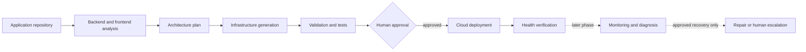

<p align="center">
  <picture>
    <source media="(prefers-color-scheme: dark)" srcset="assets/logo-full-on-dark.svg">
    <source media="(prefers-color-scheme: light)" srcset="assets/logo-full-on-light.svg">
    
  </picture>
</p>

<p align="center">
  
  
  
  
  
  
  
  
  
  
  
  
  
</p>

<p align="center">
  <strong>Plan and deploy cloud infrastructure for your application, with a human in control.</strong><br>
  A private project exploring AI-assisted AWS architecture and deployment.
</p>

<p align="center">
  
  
</p>

<p align="center">
  <a href="#project-status">Status</a> &middot;
  <a href="#vision">Vision</a> &middot;
  <a href="#planned-architecture">Architecture</a> &middot;
  <a href="#repository-map">Repository map</a> &middot;
  <a href="#project-access">Project access</a>
</p>

---

> **Private project:** This repository is intended for authorized project collaborators; it is not a public open-source project. **Current status:** This repository is an early scaffold, not a working deployment platform. Application, agent, and Terraform directories are placeholders; there is no runnable local application setup yet. The architecture below describes the project direction, not deployed functionality.

## Project status

| Area | Current state |
|---|---|
| Application code | Backend and frontend directories are placeholders |
| AI workflows | Agent, prompt, tool, and workflow directories are placeholders |
| Infrastructure | Terraform module and environment directories are placeholders |
| Local development | `docker-compose.yml` is currently empty |
| CI and automated tests | Pull request and `main` CI is configured; app checks skip empty scaffold directories |
| Project documentation | Architecture, API, and decision directories are ready for documentation |

The goal of this README is to explain the intended design while making clear what is and is not implemented today.

## Vision

CloudPilot aims to help a developer take an existing application from source code to a reviewed cloud deployment:

1. Analyze the application and identify its runtime, dependencies, ports, and health checks.
2. Propose an AWS architecture and generate infrastructure code.
3. Let the user inspect and edit the plan.
4. Validate the application and infrastructure before deployment.
5. Deploy only after explicit approval, then verify the result.
6. In a later phase, monitor the deployment and suggest safe, approved recovery actions.

**Safety principle:** AI can propose actions; validation rules, human approval, and cloud permissions must control what actually runs.

## Planned architecture

The diagram shows the intended flow. It is a design sketch and does not imply that these components or integrations are implemented.



### Planned components

| Component | Intended responsibility | Current status |
|---|---|---|
| Code analyzers | Identify how an application is built and run | Placeholder |
| Orchestrator | Coordinate analysis, planning, validation, approval, and deployment | Placeholder |
| Architecture agent | Produce a cloud resource plan | Placeholder |
| Terraform agent | Generate infrastructure-as-code | Placeholder |
| Validator | Check generated plans and application behavior | Placeholder |
| Backend | Provide the platform API | Placeholder |
| Frontend | Chat-based workflow and architecture editor | Placeholder |
| Monitoring and recovery | Diagnose issues and propose controlled repairs | Later-phase concept |

## Planned technology direction

These are technologies described by the project plan, not a guarantee that the current repository integrates them:

| Area | Planned direction |
|---|---|
| Frontend | React |
| Backend and agent code | Python, Pydantic |
| AI integrations | Amazon Bedrock, Model Context Protocol (MCP), retrieval-augmented generation |
| Workflow orchestration | An AWS workflow engine is under consideration |
| Cloud infrastructure | AWS and Terraform; deployment tooling remains to be defined |
| Observability | Prometheus, Grafana, and CloudWatch are candidates |

## Repository map

```text
.
├── .github/                 # CI, Dependabot, issue/PR templates, CodeRabbit config
├── ai/
│   ├── agents/              # Planned analyzer, architect, orchestrator, IaC, validator
│   ├── prompts/             # Planned prompt templates
│   ├── tests/               # Planned agent and prompt tests
│   ├── tools/               # Planned tools exposed to agents
│   └── workflows/           # Planned workflow definitions
├── assets/                  # Project logos and brand assets
├── backend/                 # Planned platform API
├── docs/
│   ├── api/                 # API documentation
│   ├── architecture/        # Architecture notes
│   └── decisions/           # Architecture decision records
├── frontend/                # Planned user interface
├── infrastructure/
│   └── terraform/
│       ├── environments/    # dev, staging, prod placeholders
│       └── modules/         # compute, load balancer, security group, VPC
├── CONTRIBUTING.md
├── CODE_OF_CONDUCT.md
├── SECURITY.md
└── docker-compose.yml       # Empty placeholder; not runnable yet
```

## Getting started

There is no runnable application setup yet. Authorized team members can help define the first working vertical slice. Before making changes, read the [contribution guide](CONTRIBUTING.md) and check the project's internal planning/issues for current priorities.

Once a runnable component and its dependencies are added, its maintainers should document setup, configuration, and verification commands here.

## Continuous integration

The GitHub Actions CI workflow runs for pull requests targeting `dev`, `testing`, or `main`, pushes to those branches, and manual dispatches. It checks patch whitespace and, when the matching project files exist:

| Area | Checks |
|---|---|
| Python backend (`backend/`) | Ruff lint, pytest, and pip-audit dependency scan |
| Python AI layer (`ai/`) | Ruff lint, pytest, and pip-audit dependency scan |
| React frontend (`frontend/`) | `npm ci`, npm audit, lint, typecheck, CI tests, and production build |
| Terraform | Formatting and configuration validation without using a cloud account |

The current scaffold has no runnable app source, so component checks report a skip until code is added. Once source exists, CI requires project metadata and tests (and, for React, a committed lockfile and the `lint`, `typecheck`, `test:ci`, and `build` npm scripts). It does not deploy or require AWS credentials.

The recommended promotion flow is feature branches → `dev` (integration) → `testing` (pre-production) → `main` (production). CI is validation only and does not deploy. Repository administrators should configure branch protection and require CI checks and reviews for all three long-lived branches; workflows cannot enable those repository settings themselves.
The `dev` and `testing` branches must exist in GitHub before their branch-specific workflows and protection rules can run.
Dependabot is configured to propose weekly updates for GitHub Actions used by CI.
CodeRabbit review settings and language-specific review guidance are in [`.coderabbit.yaml`](.coderabbit.yaml). CodeRabbit must also be installed and authorized for this private repository.

## Project access

This is a private project, not a public open-source project. Repository access and participation are managed by the project maintainers; public contributions are not accepted.

For authorized collaborators, follow [CONTRIBUTING.md](CONTRIBUTING.md), the [Code of Conduct](CODE_OF_CONDUCT.md), and [SECURITY.md](SECURITY.md). Report security concerns privately rather than in a public issue.

## Roadmap

The roadmap is directional and subject to change. Each phase needs a runnable demonstration and documented verification before it should be considered complete.

| Phase | Goal |
|---|---|
| 1 | Define and build a deployment MVP for a supported application |
| 2 | Add a reviewable architecture and editing experience |
| 3 | Add deployment monitoring and diagnosis |
| 4 | Add tightly controlled, human-approved recovery |

## Access and license

Repository access is restricted to authorized collaborators. The [MIT License](LICENSE) currently grants broad rights to anyone who obtains a copy of the source, including rights to use, modify, and redistribute it. A private GitHub repository controls who can access the repository; it does not make the MIT license proprietary. Keep MIT only if those permissions match the team's intent.
