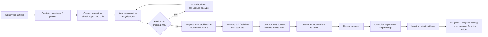

# 00 · Project Overview

## 1. Vision

Small development teams and startups can build applications but often lack cloud-architecture and DevOps expertise. CloudPilot closes that gap:

> **Point CloudPilot at a GitHub repository → get an understandable AWS architecture with security and cost → review/edit it → deploy it to your own AWS account → watch it, and get help when it breaks.**

It is **AI-assisted but human-controlled**: LLMs analyze, propose and explain; **humans approve** anything that changes real infrastructure. (`AI brief §5`: *"Do not allow LLMs to independently authorize AWS actions."*)

## 2. Users

| Persona | Needs |
|---|---|
| **Founder / solo dev** | "Just get my app on AWS without learning 30 services." |
| **Small team lead** | Shared projects, roles, an audit trail of who deployed what. |
| **Reviewer / senior dev** | Understand *why* the architecture was chosen, edit it, see the cost. |

Teams are the tenant boundary (`teams` → `projects`, `aws_accounts`, `subscriptions`). Roles: `OWNER`, `ADMIN`, `MEMBER`.

## 3. Core user journey

| Stage | Today | Where it is specified |
|---|---|---|
| Sign in | ✅ implemented | `05`, `08` |
| Team / project / repo connect | 📋 next | `03`, `05` |
| Analysis | 📋 | `06`, `contracts/` |
| Architecture proposal | 📋 | `06` |
| Edit / validate / cost | 📋 Phase 2 | `04`, `05` |
| AWS connect + deploy | 📋 Phase 2 | `08`, `09` |
| Monitoring + self-healing | 📋 Phase 3 | `02`, `04` |

## 4. Scope

### In scope for the MVP ("Phase 1" of the README roadmap)
Backend foundation, authentication, repository integration, **basic analysis and architecture proposal**, the data model. The AI brief narrows the immediate focus to: **Orchestrator + Analysis Agent first, then integrate the Architecture Agent.**

### Explicitly later
Architecture editing/validation, cost estimation, Terraform generation and **controlled deployment with approval** (Phase 2); monitoring, failure diagnosis, **policy-based self-healing** (Phase 3); evaluation/research (Phase 4).

### Out of scope / never
- Storing source code (only metadata + analysis results).
- Storing AWS secrets or Prometheus time-series in PostgreSQL.
- Executing untrusted repository code.
- LLMs authorizing AWS actions.

## 5. Roadmap from the backend README

| Phase | Theme |
|---|---|
| **1 (in progress)** | Backend foundation, auth, repository integration, basic analysis + architecture proposal, data model |
| 2 | Architecture editing, validation, cost estimation, Terraform generation, controlled deployment with approval, deployment history, conversational assistant |
| 3 | Monitoring, failure diagnosis, policy-based self-healing |
| 4 | Evaluation & research (analysis accuracy, deployment success rate, cost-estimate accuracy, manual baseline comparison) |

The AI brief has its own six implementation phases (design → orchestrator → analysis agent → comms + persistence → architecture agent + tests → deployment-MVP prep). `11-implementation-roadmap.md` merges both into one dependency-ordered plan.

## 6. Teams and ownership

| Team | Owns |
|---|---|
| **Backend** | API, auth, database, persistence, GitHub/AWS integrations |
| **AI** | Orchestrator, Analysis Agent, Architecture Agent, Communication Module contracts |
| **Frontend** (separate) | Next.js app; consumes the REST API with cookie auth |

Shared: contracts (`AnalysisReport`, error formats), lint rules (`../ruff.toml`), CI.

## 7. Guiding principles

1. **Separate responsibilities strictly.** Orchestrator coordinates; agents analyze/propose; Communication Module routes; persistence stores. No logic-mixing.
2. **Typed contracts everywhere.** Pydantic in, Pydantic out; invalid output is an error, not a guess.
3. **Traceability.** A deployment points to the exact commit and exact architecture version it used; steps are ordered so the failing step is identifiable.
4. **Least privilege & human gate.** Read-only planning is separate from write/deploy. Customer AWS access is a scoped role, never keys.
5. **Never trust the repo.** Contents are untrusted input; never executed; never put secrets in prompts or logs.
6. **Boring tech first.** PostgreSQL before queues; DB-backed jobs before Celery; add infrastructure only when load demands it.
7. **History is preserved.** Archive, don't delete (`ON DELETE RESTRICT`).

## 8. Glossary

| Term | Meaning |
|---|---|
| **Team** | Tenant/workspace; owns projects and a subscription |
| **Project** | A deployable application; has one or more connected repositories |
| **Deployment branch** | The one branch per repository whose commits are tracked and deployed |
| **Analysis (job)** | One run of the Analysis Agent on a repo @ commit → `repository_analyses` row |
| **AnalysisReport** | The validated, structured output of the Analysis Agent |
| **Architecture / version** | A named design container / an immutable numbered snapshot of the AWS design (JSONB) |
| **ArchitecturePlan** | The validated output of the Architecture Agent, stored as a version's `architecture_data` |
| **Orchestrator** | Workflow controller; decides what runs next, validates, handles timeouts/failures |
| **Communication Module** | Integration layer routing requests/results/errors between Orchestrator, agents and external APIs |
| **Blocker** | A finding that prevents deployment (e.g. no start command) |
| **Deployment step** | One ordered stage of a deployment (init, plan, apply, health check…) |
| **Incident / Healing action** | A detected problem / a proposed corrective action, gated by an approval |
| **External ID** | Per-customer value required when CloudPilot calls STS `AssumeRole` into the customer's account |