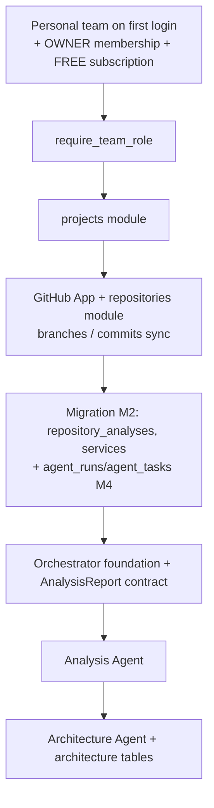

# 01 · Current State

> Snapshot of `backend.zip` (files dated up to 2026‑10‑15), cross-checked against the ERD and the AI brief.
> Everything in §1–§4 was verified by reading the code. §5–§7 are analysis.

## 1. At a glance

| Metric | Value |
|---|---|
| Stack | Python 3.12/3.14 · FastAPI · PostgreSQL 16 · SQLAlchemy 2.x · Alembic · Pydantic 2 · Next.js 16 (App Router) · React 19 · Tailwind CSS |
| Tables in the database | **16** = `users`, `teams`, `team_members`, `plans`, `subscriptions`, `projects`, `repositories`, `branches`, `commits`, `repository_analyses`, `services`, `architectures`, `architecture_versions`, `aws_accounts`, `deployments`, `deployment_steps`, `infrastructure_resources`, `approvals` |
| Migrations | **3** (`ba643e0be351` → `fb6dd2961d74` → `9f907e2152cb`), single head verified |
| HTTP endpoints | **22** (Health, Auth, Teams, Projects, Repositories, Analyses, Architectures, Deployments, Approvals) |
| Feature modules | **5 of 5 built** (`auth`, `teams`, `projects`, `repositories`, `analysis`, `architectures`, `deployments`) |
| Tests | **74** backend tests across 13 test suites; **26** frontend vitest tests across 4 test suites; 100% green |
| Quality gates | Ruff (lint+format 100% clean), mypy (0 issues in 76 source files), Next.js typegen + tsc (0 errors), Next.js build (0 errors) |
| AI layer | Deterministic Code Analyzer agent, AWS Architecture Synthesizer agent, strict Pydantic contracts |

## 2. Status matrix

| Area | Status | Notes |
|---|---|---|
| PostgreSQL + SQLAlchemy 2 + Alembic setup | ✅ | naming convention, `pool_pre_ping`, session-per-request, migration head checked |
| Phase‑1 tables (users, teams, team_members, plans, subscriptions, projects, repositories, branches, commits) | ✅ | exact DDL in `database/schema-full.sql` |
| Phase-2 tables (analyses, services, architectures, architecture_versions, aws_accounts, deployments, deployment_steps, resources, approvals) | ✅ | Migration `9f907e2152cb`, verified upgrade/downgrade |
| Seed script (plans + dev data), idempotent | ✅ | Alice OWNER, Bob ADMIN, Carol MEMBER, Acme Startup, Demo Shop |
| GitHub OAuth sign-in & dev-login | ✅ | Auto-provisions personal team, OWNER role, and FREE plan on first login |
| Tenant isolation & Team role checks (`check_team_role`) | ✅ | OWNER > ADMIN > MEMBER role hierarchy enforced across all team & project routes |
| Plan quota enforcement (`PLAN_LIMIT_REACHED`) | ✅ | FREE plan max 3 projects strictly enforced on backend (403) |
| GitHub Repository Integration | ⛔ | OAuth requests identity-only scopes; no GitHub App adapter, installation token, or real repository/commit retrieval |
| Codebase Analysis (`/repositories/{id}/analyses`) | ⚠️ | Returns canned deterministic output synchronously; does not inspect repository contents or run through a worker/Orchestrator |
| Architecture Agent (`/analyses/{id}/architectures`) | ⚠️ | Prototype synthesis uses fixed infrastructure/cost assumptions; not yet a verified ArchitecturePlan from real repository evidence |
| AWS Account Connection (`/teams/{id}/aws-accounts`) | ⚠️ | Stores an IAM role ARN and External ID as `PENDING_VERIFICATION`; no STS role assumption is implemented |
| Deployment Plan & Canonical Steps (`/projects/{id}/deployments`) | ✅ | 5 steps: VALIDATE_PERMISSIONS, SYNTHESIZE_TERRAFORM, PROVISION_INFRASTRUCTURE, DEPLOY_CONTAINER, VERIFY_HEALTH |
| Human Approval Gate (`/deployments/{id}/approve`) | ✅ | Mandatory ADMIN/OWNER approval gate before any AWS apply execution |
| Controlled AWS Deployment (`/deployments/{id}/apply`) | ⛔ | Fails closed with 503 after approval; no role verification, Terraform worker, AWS changes, or health check is implemented |
| Full-Stack Frontend Experience (`PipelineModal`, `DashboardClient`) | ✅ | Multi-stage interactive modal with live execution and health check link |


## 3. What the code does (verified walkthrough)

### 3.1 Layering (as written in the README)
**Routers handle HTTP only · services hold business logic · models describe tables · schemas define API input/output.** Only `modules/auth` follows this today.

### 3.2 Implemented endpoints

| Method | Path | Auth | Behaviour |
|---|---|---|---|
| GET | `/health/db` | – | `SELECT 1` → `{"database":"ok"}` |
| GET | `/auth/github/login` | – | random `state` → HttpOnly cookie `oauth_state` (10 min) → 307 to GitHub |
| GET | `/auth/github/callback` | – | validates state → exchanges code → fetches profile (+ primary verified email fallback) → upserts user → sets `access_token` cookie → 302 `{FRONTEND_URL}/dashboard`; handled GitHub exchange/profile failures → `/login?error=github_failed` |
| GET | `/auth/me` | ✔ | returns `UserRead` |
| POST | `/auth/logout` | – | clears cookie, 204 |
| POST | `/auth/dev-login` | – | **development only** (404 otherwise): `{github_user_id}` → `{access_token, token_type}` |

### 3.3 Data layer details worth knowing
- UUID PKs generated in Python (`uuid4`), `created_at/updated_at` via server `now()`.
- Status fields are `VARCHAR` + `CHECK` (no PG enums). **ORM-level defaults are Python-side only** (e.g. `role='MEMBER'` has no server default).
- All FKs `ON DELETE RESTRICT`. Projects are archived, not deleted.
- Two partial unique indexes enforce invariants in the DB: *one active/trialing subscription per team* and *one deployment branch per repository*.
- `Repository` stores metadata only — **source code is never stored**.

### 3.4 Config (env vars)
`DATABASE_URL`, `ENVIRONMENT` (`development` enables dev-login and non-Secure cookies), `JWT_SECRET_KEY`, `JWT_ALGORITHM`(HS256), `ACCESS_TOKEN_EXPIRE_MINUTES`(30), `FRONTEND_URL`, `GITHUB_CLIENT_ID`, `GITHUB_CLIENT_SECRET`, `GITHUB_REDIRECT_URI`. The app **fails at startup** if a required one is missing.

## 4. Test inventory (41)

| File | # | Covers |
|---|---|---|
| `test_auth_api.py` | 17 | token required/Bearer/cookie/invalid/unknown user, dev-login (incl. disabled outside dev), logout cookie, GitHub redirect + state cookie, callback success/invalid/failure, CORS allow/deny, `/health/db` |
| `test_security.py` | 8 | JWT round trip, claims only `sub/iat/exp`, wrong secret, tampering, expiry, **`alg:none`**, missing claim, non-UUID subject |
| `test_github_integration.py` | 6 | authorize URL scopes, code exchange (ok / rejected / HTTP error), profile (public email, primary-verified fallback, login-name fallback) |
| `test_auth_service.py` | 5 | first login creates user, later login refreshes without duplicate, email-collision, hidden email keeps stored, unknown id |
| `test_migrations.py` | 3 | single head, **models == migrations** (`command.check`), downgrade→base→upgrade round trip |
| `test_seed.py` | 2 | complete data counts, idempotency |

Test isolation: `conftest.py` forces all settings before importing `app`, **refuses any DB not ending in `_test`**, migrates once per session, and rolls back each test inside a savepoint.

## 5. Discrepancies between sources (decide, then fix the loser)

| # | Topic | Source A | Source B | Recommendation |
|---|---|---|---|---|
| D1 | `plans`, `subscriptions` | in **code + README** | **missing from ERD** | add both to the `.drawio` |
| D2 | Table count | README says "about 28 tables" | ERD has 24 (+2 in code = 26) | README includes an **Audit** domain the ERD lacks → see `audit_logs` 💡 |
| D3 | `repositories.github_repository_id` | ERD: **UK** (globally unique) | code: **unique per (project_id, github_repository_id)** | Code allows the same GitHub repo in several projects. Decide intent (ADR/Q‑3) |
| D4 | `commits.sha` | ERD: **UK** | code: unique per **(repository_id, sha)** | Code is correct (a SHA can appear in forks). Fix the ERD |
| D5 | Status columns | ERD shows `enum(...)` | README rule: `VARCHAR`+`CHECK`, no native enums | Implement as VARCHAR+CHECK (as DDL draft does) |
| D6 | `repository_analyses.status` | ERD: QUEUED/RUNNING/SUCCESS/FAILED | AI brief: workflow saves **"blocked"** | add `BLOCKED` (+`TIMED_OUT`) 💡 ADR‑007 |
| D7 | "Submit repo URL" | AI brief: user submits a **URL** | ERD/README: repo is connected to a **project** via GitHub App | Analysis API takes `project_id`+`repository_id`(+commit); URL is only used at *connect* time |
| D8 | `approvals` | ERD: only for `healing_actions` | README Phase 2: "controlled deployment **with approval**" | generalize to deployments 💡 ADR‑011 |
| D9 | AWS discovery | AI brief sequence diagram includes an **AWS Discovery** component | ERD has no table for discovered infra | store in `analysis_data` for MVP (Q‑5) |
| D10 | `dev-login` | README: "The cookie is set automatically" | code returns only a token in the body (no `Set-Cookie`) | fix README: use Swagger **Authorize** with the token |
| D11 | ORM version | README: "SQLAlchemy 2.0" | `requirements.txt`: `SQLAlchemy==2.1.4` | update README |

## 6. Issues & tech debt found while reading the code

| # | Sev | Finding | Fix |
|---|---|---|---|
| I1 | **High** | `backend/.gitignore` is **0 bytes**. The README says `.env` is git-ignored; that only holds if a *root* `.gitignore` covers it. `db.yml` also mounts `./pgdata` into the repo folder. | Verify the root ignore; otherwise add `.env`, `.venv/`, `pgdata/`, `__pycache__/`, `.mypy_cache/` etc. |
| I2 | Med | `requirements.txt` ends with stray unpinned lines **`pyjwt`** and **`httpx`** (no trailing newline) *after* the pinned `PyJWT==2.15.1` / `httpx==0.28.1`. Undermines reproducible builds and `pip-audit`. | Delete the two lines |
| I3 | Med | **Mixed line endings**: 31 files CRLF (app, alembic, requirements, db.yml…), 15 LF (tests, Dockerfile, README, pyproject…). No `.gitattributes` seen. | Add `.gitattributes` (`* text=auto eol=lf`) and normalize once |
| I4 | Med | No **error envelope**, request-ID, or structured logging. The AI brief demands "standard error formats". | Add `core/errors.py` + logging middleware before the next modules (`03` §6) |
| I5 | Med | No authorization layer yet (`require_team_role`). Any authenticated user is just "a user". | Build with first team endpoints |
| I6 | Med | **CSRF**: only `SameSite=Lax`. README notes an `Origin` check is needed before production. | Middleware rejecting state-changing requests with unexpected `Origin` |
| I7 | Low | Race in `upsert_github_user`: two simultaneous first logins can hit the unique constraint → HTTP 500. | Catch `IntegrityError` and re-select, or `INSERT … ON CONFLICT` |
| I8 | Low | Email collision is **silently** ignored (user keeps `email = NULL`). Acceptable, but log it. | Warn-level log without PII |
| I9 | Low | Only `/health/db`; no liveness vs readiness split; no version endpoint. | Add `/health/live`, `/health/ready` |
| I10 | Low | `Dockerfile` header mentions `docker-compose.test.yml` — not in the zip. | Add it or fix the comment |
| I11 | Low | No refresh tokens; 30‑min expiry forces re-login (documented). | Acceptable for MVP |
| I12 | Info | JWT secret has no minimum-length validation in `Settings`. | `Field(min_length=32)` |
| I13 | Info | `environment` is a free string; a typo silently flips cookie `Secure` + disables dev-login. | `Literal["development","test","staging","production"]` |

> Positive: the test suite includes the `alg:none` rejection, a "models match migrations" gate, and a safeguard against pointing tests at a non-test database. That is a stronger foundation than most MVPs.

## 7. What is blocking forward progress (critical path)



Detailed, task-level plan: [`11-implementation-roadmap.md`](11-implementation-roadmap.md).

## 8. Quick start (works today)

```bash
cd backend
python -m venv .venv && source .venv/bin/activate
pip install -r requirements-dev.txt
docker compose -f db.yml up -d
cp .env.example .env            # fill JWT_SECRET_KEY + GitHub OAuth values
alembic upgrade head
python -m app.db.seed
uvicorn app.main:app --reload   # http://localhost:8000/docs
# tests: one-time  docker exec -it cloudpilot-db psql -U cloudpilot -c "CREATE DATABASE cloudpilot_test;"
pytest --cov
```
Try without GitHub: `POST /auth/dev-login {"github_user_id":"1001"}` → paste token into Swagger **Authorize** → `GET /auth/me`.