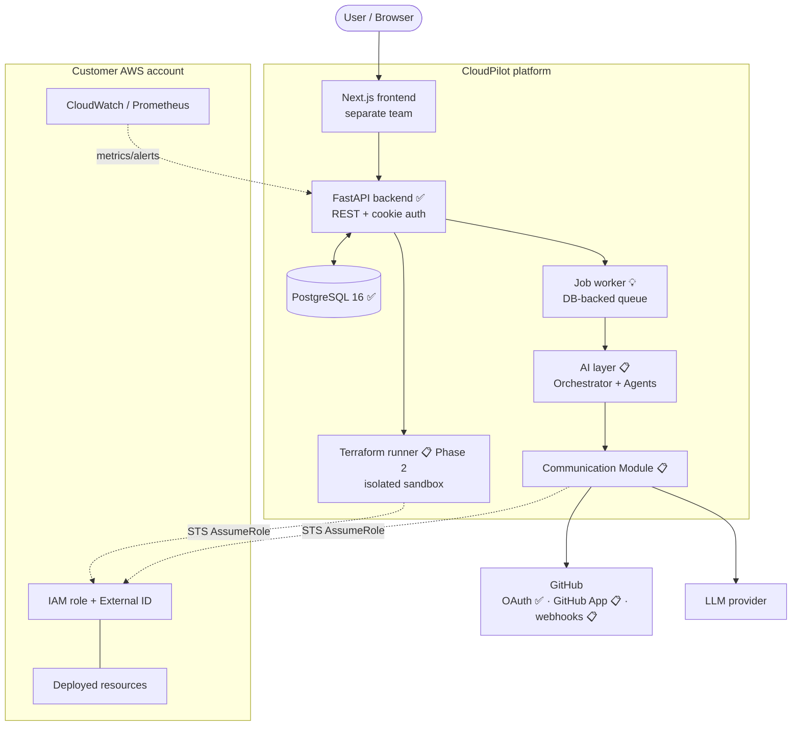
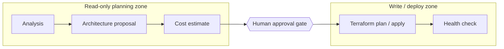
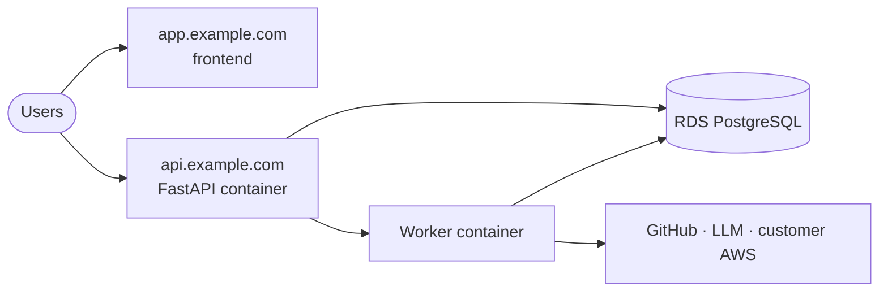

# 02 · System Architecture

> Target architecture "to the final point" (Phases 1–3), with the MVP slice clearly marked.
> ✅ = exists · 📋 = planned in team docs · 💡 = proposed here.

## 1. Context diagram



## 2. Components and their single responsibility

| Component | Responsibility | Must **not** do | Status |
|---|---|---|---|
| **FastAPI backend** | HTTP API, authN/authZ, validation, persistence, job creation, status retrieval | analyze repos, choose architectures | ✅ (auth only) |
| **Orchestrator** | Controls workflow: what runs next, validates agent output, timeouts/retries/failures, job status | inspect repositories; make architecture choices | 📋 |
| **Analysis Agent** | Read an authorized repo → structured **AnalysisReport** (languages, frameworks, deps, config, entry points, blockers) | execute user code; talk to AWS; decide architecture | 📋 |
| **Architecture Agent** | AnalysisReport → **ArchitecturePlan** (AWS design, assumptions, security, cost) | run before analysis is validated; authorize deployment | 📋 |
| **Communication Module** | Route requests/results/errors/timeouts between Orchestrator, agents and external APIs (GitHub, AWS, LLM) | contain business or AI logic | 📋 |
| **Persistence (PostgreSQL)** | Job status, intermediate results, final plans, history, audit | store source code, AWS secrets, time-series | ✅ (9 tables) |
| **Job worker** | Pull queued jobs, run the Orchestrator, heartbeat | hold business rules | 💡 |
| **Terraform runner** | `init/plan/apply` generated Terraform in the customer account, step by step | apply without a recorded human approval | 📋 Phase 2 |
| **Monitoring** | Collect metrics, raise alerts | write to the customer account | 📋 Phase 3 |

The separation rule comes from `AI brief §2`: *"Avoid blurring the lines between workflow coordination and analytical logic."*

## 3. Planning vs. deploying: the capability boundary

The AI brief (Phase 6) requires documenting a strict line between **read-only/planning** and **write/deploy**.

| | Planning (read-only) | Deploying (write) |
|---|---|---|
| GitHub | contents read via GitHub App | – (never writes to the repo in MVP) |
| AWS | optional read-only discovery 💡 | create/modify/delete resources |
| Who initiates | user or webhook | **user, with explicit approval** |
| LLM role | analyze, propose, explain | **none** — LLMs cannot authorize AWS actions |
| IAM | `cloudpilot-readonly` role 💡 | `cloudpilot-deploy` role 💡 (separate ARN, scoped, time-limited sessions) |
| DB evidence | `repository_analyses`, `architecture_versions`, `cost_estimates` | `deployments`, `deployment_steps`, `infrastructure_resources`, `approvals` |



## 4. Data flow summary

1. **Identity**: GitHub OAuth (identity only) → JWT cookie. ✅
2. **Source**: GitHub App installation gives short-lived, read-only repo tokens; webhook on the **deployment branch** records `commits`. 📋
3. **Analysis**: API creates a `repository_analyses` row (+`agent_runs`) → worker → Orchestrator → Analysis Agent → validated `AnalysisReport` → `analysis_data` + `services` rows. 📋
4. **Architecture**: validated report → Architecture Agent → `ArchitecturePlan` → new `architecture_versions` row + `cost_estimates`. 📋
5. **Deployment**: user picks version + AWS account + commit → `deployments` (QUEUED) → ordered `deployment_steps` → `infrastructure_resources`. 📋
6. **Operate**: monitoring → `alerts` → `incidents` → diagnosis `agent_runs` → `healing_actions` → `approvals`. 📋

Full sequence diagrams: [`07-workflows-and-sequences.md`](07-workflows-and-sequences.md).

## 5. Deployment topology

### 5.1 Today (local development) ✅
```
Docker:  postgres:16 (cloudpilot-db, :5432)
Host:    uvicorn app.main:app  (:8000)   ←→   Next.js (:3000)
```

### 5.2 Target for the graduation demo 💡

The README requires frontend and API to share a **parent domain** (`app.` / `api.`) so the auth cookie is not third-party. Single-region, containers on ECS Fargate or one EC2 with Docker Compose is enough for a demo; see `09`.

## 6. Scalability posture (deliberately deferred)

| Concern | MVP | When load demands |
|---|---|---|
| Job execution | DB-backed queue (`FOR UPDATE SKIP LOCKED`) 💡 | Redis + Arq/Celery/RQ, or SQS |
| Artifacts (Terraform plans, logs) | JSONB / text in PG | S3 (object storage) |
| Time-series metrics | **Prometheus** (never PG) | managed Prometheus / CloudWatch |
| Semantic memory | none | `knowledge_documents` + `document_chunks` with **pgvector** (ERD footnote, "not in v1") |
| Read scaling | single PG | read replica |

The AI brief says the same: *"standard PostgreSQL is sufficient; job queues or object storage can be introduced later if performance requires it."*

## 7. Cross-cutting concerns

| Concern | Approach | Doc |
|---|---|---|
| Observability | structured JSON logs, `correlation_id` threaded API → Orchestrator → agents → DB | `03` §6 |
| Errors | one error envelope (`ErrorInfo`) from agents to API | `contracts/` |
| Security | untrusted repo, no secrets in logs/prompts, STS+External ID, RBAC from DB | `08` |
| Idempotency | seeds, upserts, deployment-per-project unique active index, job re-runs | `04` |
| Config | pydantic-settings from env; no defaults for secrets | `03` |
| Auditability | history rows are immutable; `audit_logs` 💡 | `04` |