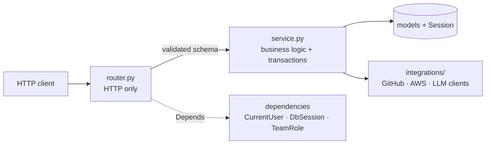
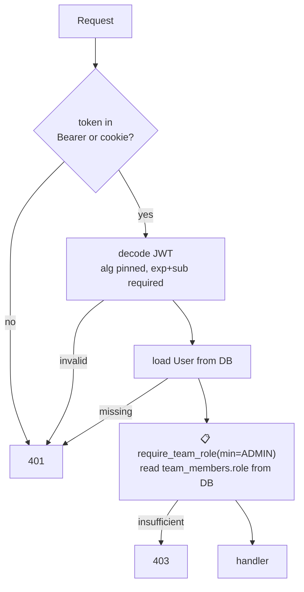
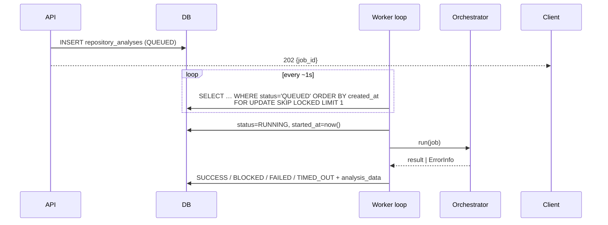

# 03 · Backend Architecture

> Style: **modular monolith** (one FastAPI app, one PostgreSQL, feature modules with strict layering).
> ✅ = in the code today · 📋 = planned · 💡 = proposed here.

## 1. The layering rule (from the backend README)

> **Routers handle HTTP only · services hold business logic · models describe tables · schemas define API input/output.**



| Layer | May import | Must not |
|---|---|---|
| `router.py` | its `schemas`, `service`, `core.dependencies`, auth `CurrentUser` | touch `Session` directly, call `integrations` directly, hold rules |
| `service.py` | `models`, `integrations`, other modules' **services** | import FastAPI, `Request`, `Response`, `HTTPException`* |
| `schemas.py` | pydantic only | import models |
| `models/` | `db.base`, mixins | import services |
| `integrations/` | `core.config`, httpx | import models/services (pure clients; return dataclasses/DTOs) |

\* 💡 services raise **domain exceptions** (`NotFound`, `Forbidden`, `Conflict`, `QuotaExceeded`); one handler in `core/errors.py` maps them to HTTP. Today `auth` still raises `HTTPException` inside the router, which is fine because the router owns HTTP, but services should not.

## 2. Folder structure

### 2.1 Today ✅

```
backend/
├── app/
│   ├── main.py                    # FastAPI(title="CloudPilot"), router, CORS, /health/db
│   ├── api/router.py              # includes feature routers (auth only)
│   ├── core/  config.py · security.py · dependencies.py
│   ├── db/    base.py · session.py · seed.py
│   ├── integrations/github.py     # OAuth client (authorize URL, token, profile)
│   ├── models/  (9 files + type.py mixins + __init__.py importing all)
│   └── modules/
│       ├── auth/        router · service · schemas · dependencies     ✅
│       ├── analysis/    router · schemas · service · __init__         (empty)
│       ├── deployments/ …                                             (empty)
│       ├── projects/    …                                             (empty)
│       └── repositories/…                                             (empty)
├── alembic/ (env.py, versions/ ×2)   ├── tests/ (6 files + conftest)
├── Dockerfile (base/test/runtime)    ├── db.yml · alembic.ini · pyproject.toml
└── requirements.txt · requirements-dev.txt · .env.example · README.md
```

### 2.2 Target 💡

```
backend/
├── app/
│   ├── main.py                    # app factory, middleware, exception handlers, lifespan
│   ├── api/router.py
│   ├── core/
│   │   ├── config.py · security.py · dependencies.py
│   │   ├── errors.py              # domain exceptions → HTTP + ErrorEnvelope
│   │   ├── logging.py             # JSON logs, correlation_id middleware
│   │   ├── permissions.py         # require_team_role(), plan-limit checks
│   │   └── middleware.py          # Origin/CSRF check, request id
│   ├── db/  base.py · session.py · seed.py · uow.py(optional)
│   ├── integrations/
│   │   ├── github.py              # OAuth (identity)                         ✅
│   │   ├── github_app.py          # installation tokens, contents, webhooks  📋
│   │   ├── aws/  sts.py · discovery.py · pricing.py · cost_explorer.py       📋
│   │   └── llm/  client.py                                                   📋
│   ├── models/                    # one file per table (27 target)
│   ├── jobs/                      # 💡 worker loop, claim/heartbeat, stale-job recovery
│   └── modules/
│       ├── auth/            ✅      ├── teams/           📋 (members, invites, roles)
│       ├── billing/         📋 (plans, subscriptions, limits)
│       ├── projects/        📋      ├── repositories/    📋 (connect, branches, commits, webhook)
│       ├── analysis/        📋 (jobs API; calls the AI layer via Comm. Module)
│       ├── architectures/   📋 (versions, edit, validate, cost)
│       ├── aws_accounts/    📋 (connect, verify)
│       ├── deployments/     📋 (create, steps, resources, approve, cancel)
│       ├── monitoring/      📋 (configs, alerts)
│       ├── incidents/       📋 (incidents, healing, approvals)
│       ├── costs/           📋 └── audit/  💡
└── …
```

**Where does the AI layer live? (open question Q‑1.)** The README mentions a *separate* AI layer sharing `../ruff.toml`. Recommended 💡: keep it a **sibling package** (`ai/`) with a narrow public API (`run_analysis(AnalysisRequest) -> AgentResult[AnalysisReport]`), imported **in-process** by the backend worker for the MVP, with the same contracts usable over HTTP later. The backend owns *jobs and persistence*; the AI layer owns *workflow and reasoning*.

## 3. Module design (what each module owns)

Every module has the same four files: `router.py`, `schemas.py`, `service.py`, `__init__.py` (+ `dependencies.py` if needed). All routes require auth except the ones marked public.

| Module | Tables | Core responsibilities | Depends on |
|---|---|---|---|
| **auth** ✅ | `users` | GitHub OAuth, JWT cookie, `/auth/me`, **create personal team on first login** 📋 | integrations.github |
| **teams** 📋 | `teams`, `team_members` | list/rename team, invite/remove members, change role, protect "last OWNER" | auth, billing |
| **billing** 📋 | `plans`, `subscriptions` | current plan, limit checks (`max_projects`, `max_team_members`, `max_deployments_per_month`) | teams |
| **projects** 📋 | `projects` | CRUD, **archive** (not delete), quota enforcement | teams, billing |
| **repositories** 📋 | `repositories`, `branches`, `commits` | GitHub App install, connect repo, choose deployment branch (exactly one), webhook → commit records | projects, integrations.github_app |
| **analysis** 📋 | `repository_analyses`, `services`, `agent_runs`, `agent_tasks` | create analysis job (202), job status, results, re-run | repositories, jobs, AI layer |
| **architectures** 📋 | `architectures`, `architecture_versions`, `cost_estimates` | generate via agent, user edit → new version, validate, estimate cost | analysis, AI layer |
| **aws_accounts** 📋 | `aws_accounts` | generate External ID, show CloudFormation/Terraform role snippet, verify via STS | teams, integrations.aws |
| **deployments** 📋 | `deployments`, `deployment_steps`, `infrastructure_resources`, `approvals` | create, approve, run steps, cancel, retry, history | architectures, aws_accounts, repositories |
| **monitoring** 📋 | `monitoring_configs`, `alerts` | configure, ingest alerts | deployments |
| **incidents** 📋 | `incidents`, `healing_actions`, `approvals` | open/diagnose/mitigate/resolve, propose & gate healing | monitoring, AI layer |
| **costs** 📋 | `cost_records` (+ `cost_estimates`) | import actual cost, compare to estimate | aws_accounts |
| **audit** 💡 | `audit_logs` | append-only trail of sensitive actions | all |

### 3.1 Cross-module rules
- Modules call each other **only through services** (never import another module's router or touch its tables directly except via its service).
- Writes to **history tables** (`commits`, `deployment_steps`, `agent_*`, `audit_logs`) are append-only in application code.
- Team scoping is mandatory: every query on a team-owned entity joins up to `team_id` and is filtered by the caller's membership.

## 4. Authentication & authorization (✅ authN, 📋 authZ)



Role matrix 💡 (to be confirmed by the team):

| Action | MEMBER | ADMIN | OWNER |
|---|:-:|:-:|:-:|
| View projects, analyses, architectures, deployments | ✔ | ✔ | ✔ |
| Trigger analysis, create/edit architecture versions | ✔ | ✔ | ✔ |
| Connect repository, create/archive project | – | ✔ | ✔ |
| Connect AWS account | – | ✔ | ✔ |
| **Approve & run deployment**, approve healing actions | – | ✔ | ✔ |
| Manage members/roles | – | members only | ✔ |
| Change plan, delete team data | – | – | ✔ |

JWT carries **only** `sub/iat/exp`. Roles are re-read per request because "roles can change while a token is still valid" (README).

## 5. Persistence conventions

| Topic | Convention |
|---|---|
| Session | one `Session` per request via `get_db`; services call `commit()` at the end of a use case (one transaction per use case) |
| IDs | UUID v4 generated in Python |
| Time | `TIMESTAMPTZ`, UTC; `now()` server defaults for `created_at` |
| Status | `VARCHAR` + `CHECK` (never native enum) |
| Flexible data | `JSONB` (`analysis_data`, `architecture_data`, `limits`, `metadata`…) validated by Pydantic **before** write |
| Deletes | `ON DELETE RESTRICT`; archive with `status` |
| Migrations | Alembic, **one migration per phase/domain**; CI test `command.check` forbids model drift; every revision auto-formatted by Ruff hooks |
| Naming | constraint names via `naming_convention` (`pk_`, `fk_`, `uq_`, `ix_`, `ck_`) |
| Secrets | never in PG; OAuth tokens not stored |
| Seeds | idempotent `get_or_create` |

## 6. Cross-cutting infrastructure to add before the next modules 💡

1. **Error envelope** — one JSON shape for all errors (mirrors `ErrorInfo` from `contracts/`):
   ```json
   { "error": { "code": "REPOSITORY_NOT_FOUND", "message": "…", "correlation_id": "…", "details": {} } }
   ```
2. **Correlation ID** — middleware sets/propagates `X-Request-ID`; stored on `agent_runs.input_data` and logged.
3. **Structured logging** — JSON; never log tokens, `Authorization`, cookies, repo content, or env values.
4. **Origin check** for state-changing requests (README security note).
5. **Pagination** — `limit/offset` (or cursor) on list endpoints; default 20, max 100.
6. **`/health/live` & `/health/ready`**.
7. **Settings hardening** — `Literal` environments, min JWT secret length.

## 7. Background jobs 💡

Analysis, architecture generation and deployments are long-running. MVP design (no new infrastructure):



- **Heartbeat + stale recovery**: a sweeper marks `RUNNING` jobs with no progress for *N* minutes as `TIMED_OUT` (or re-queues if retryable).
- Same pattern serves `deployments` (QUEUED → RUNNING) and healing actions.
- Swap-out path: replace the claim loop with Celery/Arq/SQS without changing the API or tables.

## 8. Quality gates (✅ already enforced)

`ruff check` + `ruff format --check` · `mypy` (strict-ish, pydantic plugin) · `pytest --cov` (≥ 90 %) · `pip-audit` · Docker `test` stage · migrations single-head and in-sync checks. New modules must keep these green.