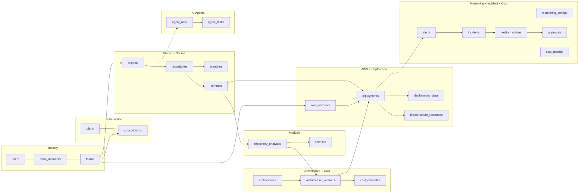

# 04 · Database Design

> PostgreSQL 16 · SQLAlchemy 2 · Alembic. Target schema = **27 tables** in 13 domains (24 from the ERD + `plans` and `subscriptions` from the code + `audit_logs` 💡).
> Full detail: [`database/data-dictionary.md`](database/data-dictionary.md) · diagrams: [`database/erd.md`](database/erd.md) · DDL draft: [`database/schema-full.sql`](database/schema-full.sql) · original: [`diagrams/CloudPilot_ERD.drawio`](diagrams/CloudPilot_ERD.drawio).

## 1. Design principles (from the README, all ✅ followed by the 9 existing tables)

| # | Rule | Why |
|---|---|---|
| 1 | **History is preserved.** A deployment references the *exact commit* and *exact architecture version* it used. | reproducibility, audit, research evaluation (Phase 4) |
| 2 | **Deployments have ordered steps.** | identify the failing step and its error |
| 3 | **Flexible AI/architecture data is `JSONB`**, not a table per AWS service. | AWS design space is open-ended; contracts are validated in Pydantic |
| 4 | **`VARCHAR` + `CHECK`** instead of native enums. | enums are painful to alter in Alembic |
| 5 | **`ON DELETE RESTRICT`**; projects are **archived**, never deleted. | prevent accidental history loss |
| 6 | **Never store**: Prometheus time-series, AWS secrets, source code, GitHub OAuth tokens. | security, size |
| 7 | **AWS access via customer IAM role + External ID + STS `AssumeRole`.** No IAM users for team members. | no long-lived credentials |
| 8 | UUID primary keys; `TIMESTAMPTZ`; predictable constraint names (`pk_/fk_/uq_/ix_/ck_`). | reliable migrations |
| 9 | One Alembic migration **per phase/domain**. | reviewable, reversible |

## 2. Domain map



| Domain | Tables | Status |
|---|---|---|
| Identity | `users`, `teams`, `team_members` | ✅ |
| Subscription | `plans`, `subscriptions` | ✅ (missing from ERD) |
| Project | `projects` | ✅ |
| Source Control | `repositories`, `branches`, `commits` | ✅ |
| Analysis | `repository_analyses`, `services` | 📋 |
| Architecture | `architectures`, `architecture_versions` | 📋 |
| AWS | `aws_accounts` | 📋 |
| Deployment | `deployments`, `deployment_steps`, `infrastructure_resources` | 📋 |
| AI Agents | `agent_runs`, `agent_tasks` | 📋 |
| Monitoring | `monitoring_configs`, `alerts` | 📋 |
| Incident / Healing | `incidents`, `healing_actions`, `approvals` | 📋 |
| Cost | `cost_estimates`, `cost_records` | 📋 |
| Audit | `audit_logs` | 💡 |

## 3. The traceability spine

The red edges of the ERD define what the platform must always be able to answer:

```
Team → Project → Repository → Commit → Deployment → DeploymentSteps / InfrastructureResources
Project → Incident → HealingAction → Approval
ArchitectureVersion ← source_analysis_id ← RepositoryAnalysis (@ Commit)
```

| Question | Answered by |
|---|---|
| *Which code is running?* | `deployments.commit_id → commits.sha` |
| *Which design was applied, and why?* | `deployments.architecture_version_id → architecture_versions.source_analysis_id → repository_analyses.analysis_data` |
| *Into which account, started by whom?* | `deployments.aws_account_id`, `deployments.created_by` |
| *Where did it fail?* | `deployment_steps` ordered by `step_order`, with `error_code/message` |
| *What exists in AWS now?* | `infrastructure_resources` |
| *What did the AI do and with what input?* | `agent_runs` / `agent_tasks` (`input_data`, `output_data`, `model`) |
| *Who allowed a risky fix?* | `approvals.approved_by` ← `healing_actions` ← `incidents` |

## 4. Mapping the AI brief's "analysis job" onto the schema

The brief describes: *job id → status → intermediate results → final proposal*. The ERD already models this; no extra "jobs" table is needed.

| Brief concept | Table / column |
|---|---|
| Analysis **job** & **job status** | `repository_analyses.status` (+ `started_at`, `completed_at`, `error_code`, `error_message`) |
| **AnalysisReport** (intermediate result) | `repository_analyses.analysis_data` (JSONB, validated) |
| Detected **services** | `services` rows (one per `DetectedService`) |
| Orchestrator/agent **execution trace** | `agent_runs` (one per agent execution) + `agent_tasks` (ordered steps: fetch, detect, validate…) |
| **ArchitecturePlan** (final proposal) | `architecture_versions.architecture_data` (JSONB, validated) with `status` |
| **Cost** | `cost_estimates` (`breakdown` JSONB) |
| "Request job status" (API) | `GET` reads the persisted `repository_analyses` / `architecture_versions` rows |

## 5. Invariants and where they are enforced

| Invariant | DB enforcement | App enforcement |
|---|---|---|
| One active/trialing subscription per team ✅ | partial unique index `uq_subscriptions_one_active_per_team` | billing service |
| One deployment branch per repository ✅ | partial unique index `uq_branches_one_deployment_branch` | repositories service |
| Valid roles / statuses ✅ | `CHECK` constraints | schemas |
| A commit is unique per repository ✅ | `UNIQUE(repository_id, sha)` | webhook handler (idempotent insert) |
| A repo is connected once per project ✅ | `UNIQUE(project_id, github_repository_id)` | repositories service |
| One approval per healing action | `UNIQUE(healing_action_id)` | incidents service |
| Approval targets exactly one subject 💡 | `CHECK (num_nonnulls(healing_action_id, deployment_id)=1)` | |
| Architecture version numbers don't collide 💡 | `UNIQUE(architecture_id, version_number)` | allocate `max+1` in a transaction |
| Steps/tasks have one position 💡 | `UNIQUE(deployment_id, step_order)`, `UNIQUE(agent_run_id, step_order)` | |
| No concurrent deployments per project 💡 | partial unique index on `deployments(project_id) WHERE status IN ('QUEUED','RUNNING')` | deployments service |
| Plan limits (projects/members/deployments per month) | – (counted) | billing service reading `plans.limits` |
| Team scoping of every query | – | `permissions.py` |
| Never delete projects | `ON DELETE RESTRICT` | archive endpoint |

## 6. JSONB documents (validated by Pydantic before write)

| Column | Contract | Notes |
|---|---|---|
| `repository_analyses.analysis_data` | `AnalysisReport` (`contracts/`) | includes `schema_version` |
| `architecture_versions.architecture_data` | `ArchitecturePlan` | immutable once approved |
| `cost_estimates.breakdown` | `CostEstimate.lines` | currency + basis per line |
| `agent_runs.input_data / output_data` | request / `AgentResult` | **redact** secrets; large content stored as references |
| `agent_tasks.*_data` | per task type | |
| `deployment_steps.input_data / output_data` | per `step_type` | Terraform plan summary, not state |
| `monitoring_configs.configuration` | monitoring schema | |
| `incidents.metadata`, `alerts.metadata`, `healing_actions.action_data` | free-form, bounded size | |
| `plans.limits` ✅ | `{max_projects, max_team_members, max_deployments_per_month}` | |

Guideline: JSONB for *documents you read whole*; promote a field to a real column the moment you need to filter/sort/join on it (e.g. `services` was normalized out of the report for this reason).

## 7. ERD gaps & proposed changes 💡

None of these are decided; each is cheap to adopt **before** the migration is written.

| # | Proposal | Reason | Table(s) |
|---|---|---|---|
| P1 | Add `plans`, `subscriptions` to the `.drawio` | exist in code, absent in ERD | – |
| P2 | Add **`external_id`** (unique) to `aws_accounts` | README mandates STS + External ID, ERD has nowhere to keep it | `aws_accounts` |
| P3 | Add **`created_at`** to job-like tables | `started_at` is `NULL` while `QUEUED`; the worker needs a stable ordering | `repository_analyses`, `deployments`, `agent_runs`, `agent_tasks`, `deployment_steps` |
| P4 | Add `requested_by` (nullable FK users) and `report_schema_version` | who triggered it; contract versioning | `repository_analyses` |
| P5 | Extend `repository_analyses.status` with **`BLOCKED`** and **`TIMED_OUT`** | brief: "Save findings & blocked"; timeouts are first-class (ADR‑007) | `repository_analyses` |
| P6 | Generalize **`approvals`** to deployments (`deployment_id`, exactly-one CHECK) | README Phase 2 "controlled deployment with approval"; brief "no LLM authorization" (ADR‑011) | `approvals` |
| P7 | Uniqueness: live AWS accounts `(team_id, aws_account_id)` excluding `DISCONNECTED` rows, `(architecture_id, version_number)`, step/task order | integrity and account reconnection | several |
| P8 | **Active-deployment unique index** per project | prevent concurrent Terraform runs against one project | `deployments` |
| P9 | Add `usage jsonb` (tokens, latency) to `agent_runs` | cost control + evaluation (Phase 4) | `agent_runs` |
| P10 | Add **`audit_logs`** | README lists an *Audit* domain not in the ERD | new |
| P11 | Decide `repositories.github_repository_id` scope (D3) | ERD says global UK, code says per-project | `repositories` |
| P12 | Store **two role ARNs** on `aws_accounts` (`readonly_role_arn`, `role_arn` = deploy) instead of a `capability` flag. *`schema-full.sql` implements this variant.* | enforce planning/deploy boundary (ADR‑010) | `aws_accounts` |
| P13 | Future (ERD footnote, not v1): `knowledge_documents` / `document_chunks` with **pgvector** | RAG for the assistant | new |

## 8. Migration plan (one revision per domain)

| Rev | Content | Depends on | Status |
|---|---|---|---|
| **M1** | `users` → `plans, teams, projects, subscriptions, team_members, repositories, branches, commits` | – | ✅ done (2 revisions: `ba643e0be351`, `fb6dd2961d74`) |
| **M2** | `repository_analyses`, `services` | `repositories`, `commits` | 📋 |
| **M3** | `agent_runs`, `agent_tasks` — **create without the FKs to `deployments`/`incidents`** | `projects` | 📋 (ADR‑012) |
| **M4** | `architectures`, `architecture_versions`, `cost_estimates` | M2, `users` | 📋 |
| **M5** | `aws_accounts`, `deployments`, `deployment_steps`, `infrastructure_resources` **+ add `agent_runs.deployment_id` FK** | M3, M4 | 📋 |
| **M6** | `monitoring_configs`, `alerts`, `cost_records` | M5 | 📋 |
| **M7** | `incidents`, `healing_actions`, `approvals` **+ add `agent_runs.incident_id` FK** | M3, M6 | 📋 |
| **M8** | `audit_logs` (could move earlier; useful from the first team endpoints) | – | 💡 |

**Circular-dependency note (ADR‑012).** `agent_runs` has nullable FKs to both `deployments` and `incidents`, while `healing_actions` points back to `agent_runs`. The AI orchestration work (analysis, architecture) needs `agent_runs` *long before* deployments or incidents exist. So create `agent_runs` in M3 with `deployment_id` / `incident_id` as plain nullable UUID columns, and add the two FK constraints with `op.create_foreign_key` in M5 and M7.

Topological order of all 27 tables (used by `schema-full.sql`):
`users, teams, team_members, plans, subscriptions, projects, repositories, branches, commits, repository_analyses, services, architectures, architecture_versions, cost_estimates, aws_accounts, deployments, deployment_steps, infrastructure_resources, monitoring_configs, alerts, cost_records, incidents, agent_runs, agent_tasks, healing_actions, approvals, audit_logs`.

Migration rules (already enforced in CI): single head; models == migrations (`command.check`); downgrade-to-base then upgrade round trip. Always review autogenerate output; `upgrade()`/`downgrade()` must not be `pass`.

## 9. Indexing strategy

Rule: **every FK gets an index** (the code already does this), plus:

| Index | Purpose |
|---|---|
| `repository_analyses (status, created_at)` 💡 | worker polling |
| `deployments (project_id, created_at DESC)` 💡 | deployment history list |
| `deployments (project_id) WHERE status IN ('QUEUED','RUNNING')` unique 💡 | concurrency guard |
| `commits (repository_id, committed_at DESC)` 💡 | history views |
| `alerts (project_id, status)`, `incidents (project_id, status)` 💡 | dashboards |
| `audit_logs (team_id, created_at DESC)` 💡 | audit view |
| GIN on JSONB | **only if** a query proves it necessary (not by default) |

## 10. Data lifecycle & retention 💡

| Data | Retention |
|---|---|
| `commits`, `deployments`, `deployment_steps`, `approvals`, `audit_logs` | keep (history is the product) |
| `agent_runs` / `agent_tasks` `input_data/output_data` | keep summaries; **truncate/redact** large payloads after N days |
| `alerts` | keep resolved alerts N months |
| Raw metrics | **not in PostgreSQL** (Prometheus) |
| Repository content | **never persisted**; fetched on demand, held in memory/tmp for the job only |

## 11. Seed & reference data ✅

`seed_reference_data`: `FREE` ($0; 1 project, 3 members, 10 deployments/month) and `STANDARD` ($29; 10 / 10 / 200). `seed_dev_data`: 3 users (OWNER/ADMIN/MEMBER), team "Acme Startup" on FREE, project "Demo Shop", repo `acme/demo-shop`, `main` as deployment branch, 3 commits. Both idempotent (`get_or_create`). 📋 Add seeds for analysis/architecture sample data once those tables exist, so the frontend team can build screens before the AI layer is finished.