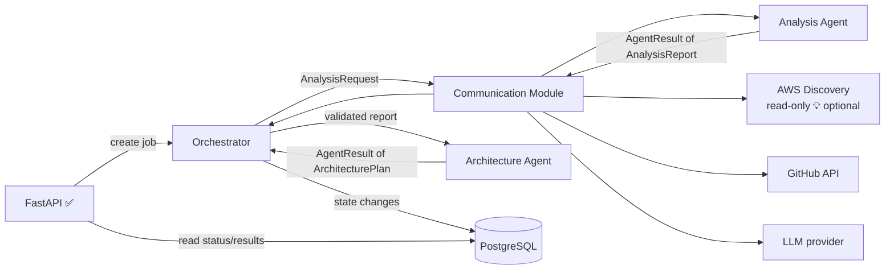
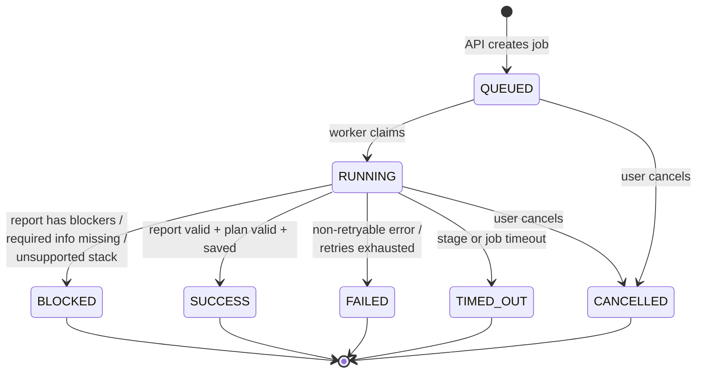
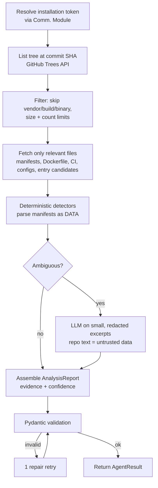

# 06 · AI Orchestration (Orchestrator · Analysis Agent · Architecture Agent · Communication Module)

> Source: *CloudPilot AI Team — Analysis & Orchestration Implementation Brief*. Everything stated by the brief is marked **(brief)**. Details the brief leaves open are 💡 proposals to review. **No AI-layer code was available**, so all of this is 📋 planned.

## 1. Required components and strict boundaries (brief §2)

| Component | Does | Never does |
|---|---|---|
| **Orchestrator** | Controls the workflow; decides which component runs next; validates outputs; handles timeouts and failures; coordinates the overall process | inspect repositories; make architecture choices |
| **Analysis Agent** | Inspects an *authorized* GitHub repo → languages, frameworks, dependencies, config files, deployment blockers → structured **AnalysisReport** | execute user code; propose architecture |
| **Architecture Agent** | Takes a *validated* AnalysisReport → proposes AWS architecture; handles assumptions, security, cost. Integrated **only after** the analysis workflow is proven | run on unvalidated input; authorize AWS actions |
| **Communication Module** | Routes requests, results, errors between Orchestrator, agents, and external APIs (AWS, GitHub); a *separate integration layer* | contain business or AI logic |
| **Persistence** | Stores job status, intermediate analysis results, final proposals. **PostgreSQL is sufficient**; queues/object storage later | – |



Dependency direction: **Orchestrator → Communication Module → agents/external**. Agents never call each other; they never call the database; only the Orchestrator's persistence hook (owned by the backend) writes state.

## 2. Contracts (brief Phase 1: "agree on the exact data exchange format before writing application logic")

Draft models: [`contracts/ai_contracts.py`](contracts/ai_contracts.py) · explained in [`contracts/ai-contracts.md`](contracts/ai-contracts.md).

| Contract | Direction | Stored in |
|---|---|---|
| `AnalysisRequest` | Orchestrator → Analysis Agent | `agent_runs.input_data` (secrets excluded) |
| `AnalysisReport` | Analysis Agent → Orchestrator | `repository_analyses.analysis_data` + `services` rows |
| `ArchitecturePlan` | Architecture Agent → Orchestrator | `architecture_versions.architecture_data` |
| `AgentResult[T]` | every agent → Orchestrator (exactly one of `result`/`error`) | `agent_runs.output_data` |
| `ErrorInfo` (+`ErrorCode`, `Stage`) | any → Orchestrator → API | `error_code`, `error_message` columns |

Rules (brief §5): **strictly typed, validated inputs/outputs (Pydantic)**; unknown fields rejected; invalid output is an *error*, never silently repaired by the Orchestrator.

## 3. Orchestrator

### 3.1 Responsibilities (brief Phase 2)
1. Define the pipeline from repository submission to analysis completion.
2. Decide **sequential vs parallel** steps and map failure states.
3. Track job status; **strictly validate agent outputs**.
4. Own **timeouts, retries and error handling** (brief §5: "explicitly at the Orchestrator level").
5. Constraint: *zero repository-inspection logic*.

### 3.2 Pipeline

| # | Step | Mode | Failure → |
|---|---|---|---|
| 1 | Mark job `RUNNING` | seq | `PERSISTENCE_FAILED` |
| 2 | Analyze repo (Analysis Agent) **‖** Discover infra (read-only AWS, optional) | **parallel** (brief sequence: "Analyze repo & infra") | each has its own error; infra failure is *non-fatal warning* 💡 |
| 3 | Validate & combine → `AnalysisReport` | seq | `SCHEMA_VALIDATION_FAILED` / `LLM_INVALID_OUTPUT` |
| 4 | Evaluate blockers (`report.is_deployable`) | seq | – |
| 5a | **Blocked / info missing** → save findings, status `BLOCKED`, stop | branch | – |
| 5b | **Sufficient** → Architecture Agent | seq | `LLM_*`, `STAGE_TIMEOUT` |
| 6 | Validate `ArchitecturePlan` | seq | `SCHEMA_VALIDATION_FAILED` |
| 7 | Save plan + status | seq | `PERSISTENCE_FAILED` |

### 3.3 State machine



`BLOCKED` is **not a failure**: the system worked, the *repository* is not deployable yet (or needs user input). The ERD currently lacks `BLOCKED`/`TIMED_OUT` (ADR‑007 💡).

### 3.4 LangGraph 💡 (brief: "Consider LangGraph here specifically for its workflow orchestration benefits"; "use LangChain only when its abstractions genuinely save time")

Why it fits: explicit nodes/edges, conditional routing (blocked vs OK), parallel fan-out/fan-in, per-node timeouts/retries, resumable state. Keep **nodes thin**: each node calls the Communication Module and updates typed state; no analysis logic inside.

```python
# SKETCH ONLY - verify against the installed langgraph version.
from typing import TypedDict
from langgraph.graph import StateGraph, START, END

class JobState(TypedDict, total=False):
    request: AnalysisRequest
    repo_findings: AnalysisReport | None
    infra_findings: dict | None
    report: AnalysisReport | None
    plan: ArchitecturePlan | None
    error: ErrorInfo | None
    outcome: str          # "SUCCESS" | "BLOCKED" | "FAILED" | "TIMED_OUT"

g = StateGraph(JobState)
g.add_node("mark_running", mark_running)
g.add_node("analyze_repo", analyze_repo)        # -> Communication Module -> Analysis Agent
g.add_node("discover_infra", discover_infra)    # optional, read-only
g.add_node("validate_combine", validate_combine)
g.add_node("evaluate", evaluate)                # sets outcome via report.is_deployable
g.add_node("save_blocked", save_blocked)
g.add_node("architect", architect)              # -> Architecture Agent
g.add_node("validate_plan", validate_plan)
g.add_node("save_success", save_success)
g.add_node("save_failure", save_failure)

g.add_edge(START, "mark_running")
g.add_edge("mark_running", "analyze_repo")
g.add_edge("mark_running", "discover_infra")          # parallel fan-out
g.add_edge(["analyze_repo", "discover_infra"], "validate_combine")  # fan-in
g.add_conditional_edges("validate_combine", lambda s: "fail" if s.get("error") else "ok",
                        {"ok": "evaluate", "fail": "save_failure"})
g.add_conditional_edges("evaluate", lambda s: s["outcome"],
                        {"BLOCKED": "save_blocked", "SUCCESS": "architect", "FAILED": "save_failure"})
g.add_edge("architect", "validate_plan")
g.add_conditional_edges("validate_plan", lambda s: "fail" if s.get("error") else "ok",
                        {"ok": "save_success", "fail": "save_failure"})
for n in ("save_blocked", "save_success", "save_failure"):
    g.add_edge(n, END)
graph = g.compile()
```

**Milestone ordering (brief):** first ship the graph **without** `architect`/`validate_plan` (analysis-only), prove it end-to-end, *then* add the Architecture Agent (brief Phase 5).

### 3.5 Timeouts & retries 💡 (numbers are starting points to tune)

| Stage | Timeout | Retries | Retry when | Never retry |
|---|---|---|---|---|
| Fetch repository (GitHub) | 60 s | 3, exp. back-off + jitter | 5xx, network, rate limit (honor `Retry-After`) | `GITHUB_UNAUTHORIZED`, `REPOSITORY_NOT_FOUND` |
| Analysis Agent | 180 s | 1 | `LLM_TIMEOUT`, `LLM_UNAVAILABLE` | `UNSUPPORTED_STACK` |
| LLM output invalid | – | **1 repair attempt** (re-prompt with validation error) | `LLM_INVALID_OUTPUT` | second failure → `FAILED` |
| AWS discovery | 60 s | 2 | throttling | access denied → warning |
| Architecture Agent | 180 s | 1 | as above | – |
| Persistence | 10 s | 3 | transient DB | – |
| **Whole job** | 600 s | – | – | → `TIMED_OUT` |

Each retry is logged on the corresponding `agent_tasks` row (attempt number in `output_data`).

### 3.6 Failure-state map (brief Phase 1: "map out the expected workflow failure states")

| Failure | `ErrorCode` | Job outcome | User-visible |
|---|---|---|---|
| Repo not found / app not installed | `REPOSITORY_NOT_FOUND`, `GITHUB_UNAUTHORIZED` | `FAILED` | "Reconnect GitHub / grant access" |
| GitHub rate limit | `GITHUB_RATE_LIMITED` | retry → `FAILED` | "Try again later" |
| Repo too large | `REPOSITORY_TOO_LARGE` | `FAILED` | "Select a sub-path" |
| Unsupported technology | `UNSUPPORTED_STACK` | `BLOCKED` | list of unsupported items |
| Required info missing | `REQUIRED_INFO_MISSING` | `BLOCKED` | questions to answer → re-run |
| LLM slow / down | `LLM_TIMEOUT`, `LLM_UNAVAILABLE` | retry → `FAILED` | |
| LLM returns invalid JSON | `LLM_INVALID_OUTPUT` | repair once → `FAILED` | |
| Contract violation | `SCHEMA_VALIDATION_FAILED` | `FAILED` | internal; ticket |
| Stage / job exceeds time | `STAGE_TIMEOUT`, `JOB_TIMEOUT` | `TIMED_OUT` | |
| AWS discovery fails | `AWS_DISCOVERY_FAILED` | continue (warning) | |
| DB write fails | `PERSISTENCE_FAILED` | `FAILED` | |
| Anything else | `INTERNAL_ERROR` | `FAILED` | |

## 4. Analysis Agent (brief Phase 3)

### 4.1 Mandate
Retrieve files through **authorized GitHub API access**; **safely parse** (never execute); detect **languages, frameworks, package dependencies, config files, entry points**; categorize **missing info, unsupported technologies, warnings, deployment blockers**; produce a **validated AnalysisReport with evidence and confidence scores**.

### 4.2 Proposed internal pipeline 💡



| Principle | Detail |
|---|---|
| **Deterministic first, LLM second** | Parse `requirements.txt`, `pyproject.toml`, `package.json`, `pom.xml`, `build.gradle`, `go.mod`, `Dockerfile`, `docker-compose.yml`, CI files, `*.tf`, `.env.example` with real parsers. Use the LLM only to interpret ambiguity (service boundaries, entry points). Cheaper, reproducible, testable. |
| **Evidence for every claim** | each detection has `Evidence(file_path, line range, short redacted excerpt)` and `confidence ∈ [0,1]` |
| **No code execution** | never run install scripts, tests, build tools, or imports from the repo. Parse text only. |
| **Limits** | max files, max bytes per file, max total bytes, wall-clock budget; set `meta.truncated=true` when hit |
| **Secrets** | env var **names** only (`EnvVar`); if a committed secret is detected, report the **path and kind** as a finding, never the value; redact before anything reaches a prompt or log |
| **Prompt-injection defense** | system prompt states repo content is data, not instructions; no tools exposed to the LLM beyond "return JSON"; output must validate against the schema (so injected instructions cannot change structure) |
| **Monorepos** | detect multiple services; report each as a `DetectedService` with `path` |

### 4.3 Blocker examples 💡 (deterministic rules → `Finding(severity=BLOCKER)`)
`NO_RUNNABLE_ENTRYPOINT` · `NO_LISTEN_PORT` · `UNSUPPORTED_LANGUAGE` · `AMBIGUOUS_MONOREPO` · `REQUIRES_LOCAL_ONLY_RESOURCE` (e.g. SQLite as primary DB) · `SECRET_COMMITTED` · `MISSING_BUILD_INSTRUCTIONS`.
Warnings: `NO_HEALTH_ENDPOINT`, `NO_LOCKFILE`, `NO_DOCKERFILE` (can be generated in Phase 2), `UNPINNED_DEPENDENCIES`.

## 5. Architecture Agent (brief Phase 5)

| Aspect | Design |
|---|---|
| Input | a **validated, non-blocked** `AnalysisReport` (+ optional user preferences: region, budget, availability target) |
| Output | `ArchitecturePlan`: components (ECS Fargate/Lambda, ALB, RDS, ElastiCache, S3, CloudFront, ECR, Secrets Manager, VPC, Route 53, CloudWatch…), `assumptions` (each with impact), `security` (network isolation, encryption, secrets, least privilege, public endpoints), `cost` (monthly total + per-component lines + pricing date + confidence), `risks` |
| Hard rules | `requires_human_approval` is always `true` (type-level `Literal[True]`); the agent cannot call AWS write APIs; every component has a `rationale`; unknown requirements become **assumptions**, not silent defaults |
| Cost | start with a static price table keyed by region/instance (deterministic), optionally refine with the AWS Pricing API; always record `pricing_as_of` |
| Persistence | new `architecture_versions` row (`version_number` = max+1, `source_analysis_id`, `status=DRAFT`) + `cost_estimates` row |
| Editing | user edits create **new versions**; versions are immutable once approved |

## 6. Communication Module

A *separate integration layer with no business or AI logic*.

| Function | Detail |
|---|---|
| Routing | Orchestrator ↔ Analysis/Architecture Agents ↔ GitHub ↔ AWS ↔ LLM |
| Credentials | resolves opaque refs (`github_installation_ref`, AWS role + External ID) into short-lived tokens **inside** the module; credentials never appear in agent prompts, contracts, or logs |
| Timeouts | enforces per-call timeouts and returns `ErrorInfo(STAGE_TIMEOUT)` instead of hanging |
| Error normalization | maps provider errors (HTTP status, boto `ClientError`, LLM errors) to `ErrorCode` + `retryable` |
| Correlation | forwards `correlation_id` on every hop |
| Transport 💡 | in-process function calls for the MVP behind a `Protocol`; the same interface can be swapped for HTTP/queue later without touching the agents |

```python
# SKETCH
class CommunicationModule(Protocol):
    def fetch_repository_files(self, req: AnalysisRequest) -> RepositorySnapshot | ErrorInfo: ...
    def run_analysis_agent(self, req: AnalysisRequest, snapshot: RepositorySnapshot) -> AgentResult[AnalysisReport]: ...
    def discover_infrastructure(self, aws_ref: str) -> AgentResult[InfraFindings]: ...
    def run_architecture_agent(self, report: AnalysisReport, prefs: Preferences) -> AgentResult[ArchitecturePlan]: ...
```

## 7. Persistence contract between AI layer and backend

The AI layer is **stateless** and returns results; the backend persists. The Orchestrator emits **state-change events** through a small hook the backend provides (brief Phase 4: *"Connect the Orchestrator state changes to database persistence"*):

| Event | Backend action |
|---|---|
| `job_started` | `repository_analyses.status=RUNNING, started_at`; insert `agent_runs` (RUNNING) |
| `task_started/finished` | upsert `agent_tasks` row (order, status, timing, error) |
| `report_ready` | write `analysis_data`; upsert `services` rows (replace set for this analysis) |
| `job_blocked` | status `BLOCKED` + report |
| `plan_ready` | insert `architecture_versions` + `cost_estimates` |
| `job_failed` / `job_timed_out` | status + `error_code` + `error_message`; `agent_runs.status` |

## 8. Security rules for the AI layer (brief §5)

1. Repository contents are **untrusted**. **Never execute user code.**
2. **Never expose secrets** in prompts or logs (redact at the Communication Module boundary).
3. **LLMs never authorize AWS actions.** Deployment requires a recorded human approval (`approvals`).
4. Least-privilege, read-only credentials during planning.
5. Bound every input (size, count) and every call (timeout, retries).
6. Treat model output as untrusted too: validate against Pydantic before use.

## 9. Mapping the brief's six phases to deliverables

| Brief phase | Deliverables | Definition of done |
|---|---|---|
| **1 Design the components** | boundaries doc; I/O for each component; `AnalysisReport` + `ErrorInfo` schemas; data-exchange format; failure-state map | contracts reviewed & merged; this folder updated |
| **2 Orchestrator foundation** | pipeline definition; sequential/parallel plan; status tracking; strict output validation; (LangGraph) | orchestrator runs a **fake** analysis agent end-to-end incl. blocked/failed/timeout paths; zero repo logic |
| **3 Analysis Agent** | GitHub fetch; safe parsing; detectors; categorization; validated report w/ evidence+confidence | golden-repo fixtures produce expected reports; no code execution; limits honored |
| **4 Communication + persistence** | Comm. Module; state-change → PostgreSQL; job status + history retrievable | `GET /analyses/{id}` returns persisted status/results; M2/M3 migrations |
| **5 Architecture Agent + tests** | `ArchitecturePlan` with assumptions/security/cost; integration tests: success, unsupported repo, API failure, invalid output, timeout | all paths covered; plan persisted as `architecture_versions` |
| **6 Prepare Deployment MVP** | map analysis+architecture → future Dockerfile/Terraform generators; list missing AWS integrations; document read-only vs write boundary | boundary doc (`02` §3) accepted; gap list in `11` |