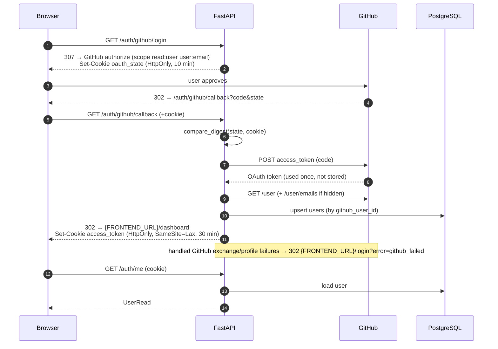
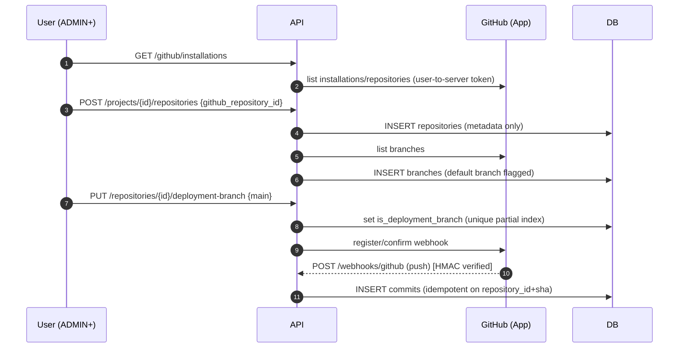
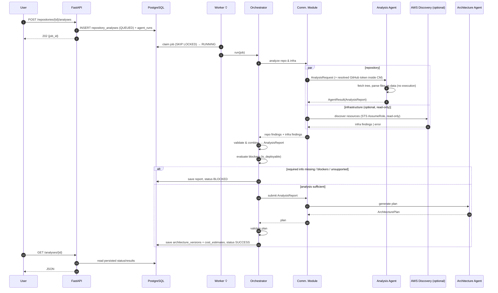
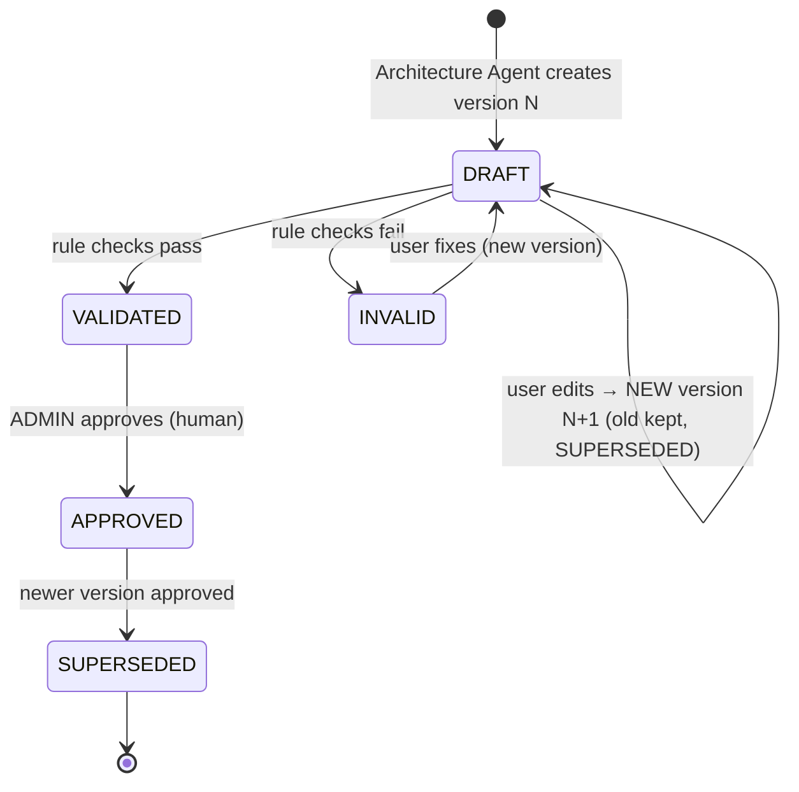
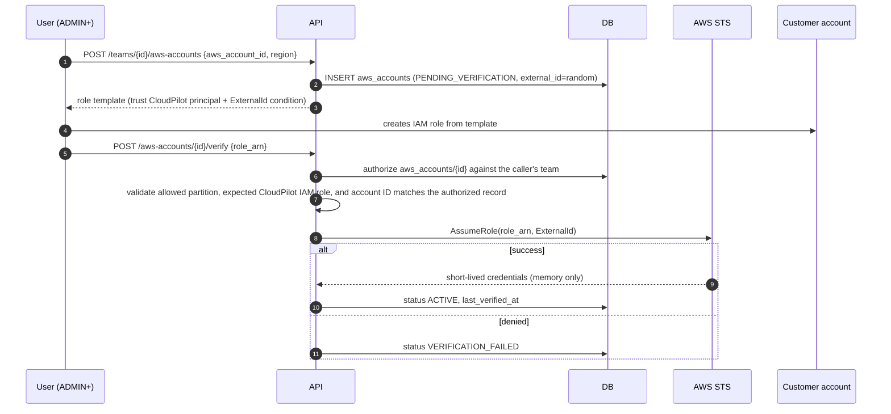
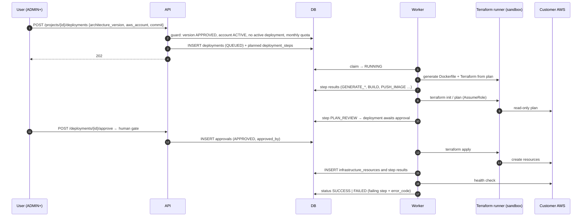
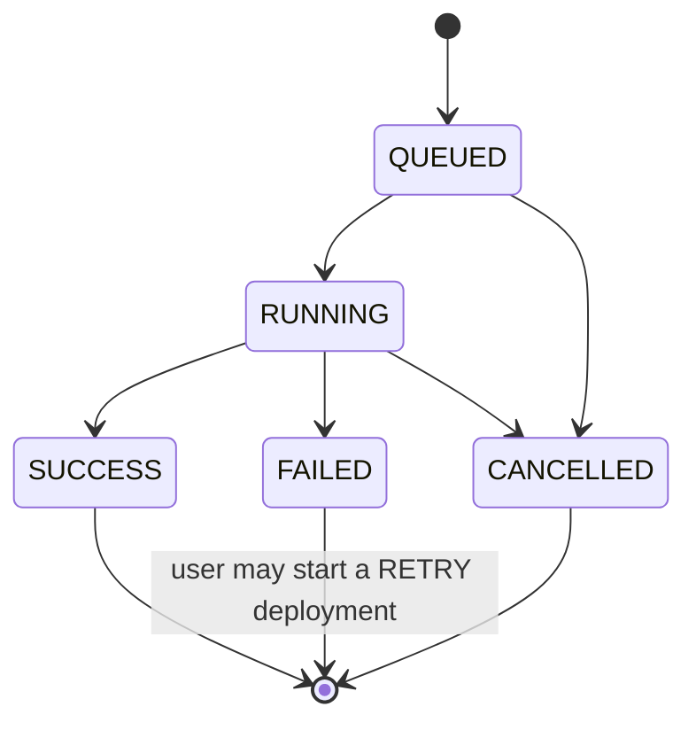
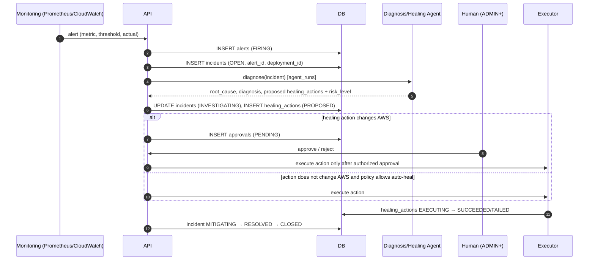
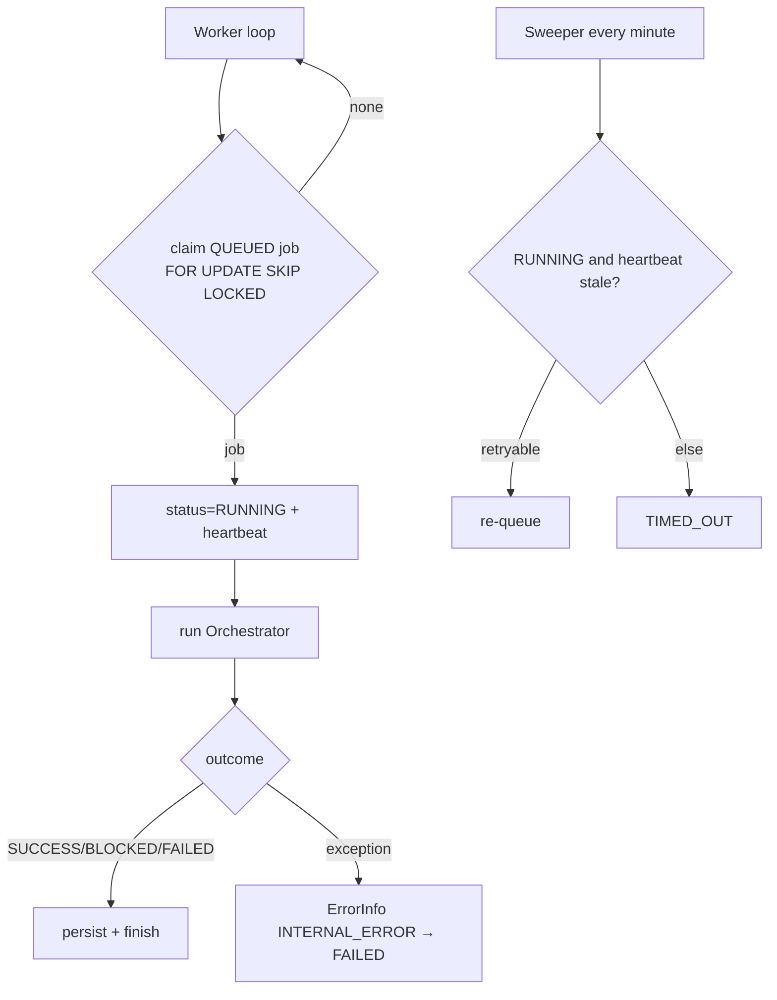

# 07 · Workflows & Sequences

> ✅ = matches code today · 📋 = from the AI brief / README · 💡 = proposed.

## 1. Sign-in with GitHub ✅

📋 **Next:** in the same transaction as `upsert_github_user` on first login, create a personal `team`, an `OWNER` `team_members` row and a `FREE` `subscription`.

## 2. Connect a repository 📋💡

Signing in does **not** grant repo access; access comes from the GitHub App installation (README).

## 3. Analysis workflow (AI brief sequence, adapted to the schema) 📋

The brief's diagram, restated with our tables:

## 4. Architecture editing & approval 📋 (Phase 2)

Version statuses are 💡 proposals (`architecture_versions.status` is an unconstrained string in the ERD).

## 5. Connect an AWS account 📋💡

No access keys are ever collected or stored.

## 6. Deployment (Phase 2) 📋💡

Proposed ordered `step_type` values 💡: `VALIDATE_PLAN` → `GENERATE_DOCKERFILE` → `BUILD_IMAGE` → `PUSH_IMAGE` → `GENERATE_TERRAFORM` → `TERRAFORM_INIT` → `TERRAFORM_PLAN` → `AWAIT_APPROVAL` → `TERRAFORM_APPLY` → `HEALTH_CHECK` → `FINALIZE`. Terraform **state lives in the customer's own S3 bucket** (ADR‑013), never in PostgreSQL.

## 7. Deployment status machine 📋

`trigger_type`: `MANUAL`, `AUTO` (push to deployment branch), `RETRY`, `HEALING`. Step status: `QUEUED, RUNNING, SUCCESS, FAILED, SKIPPED`.

## 8. Monitoring → incident → self-healing (Phase 3) 📋💡

"Policy-based self-healing" (README Phase 3) means an explicit, reviewable policy may auto-execute only actions that do not change AWS. **Default = require approval.** Every AWS-changing action requires a recorded, authorized human approval before execution through the deploy-role boundary; an LLM never holds the authority itself.

## 9. Job claiming & recovery 💡

