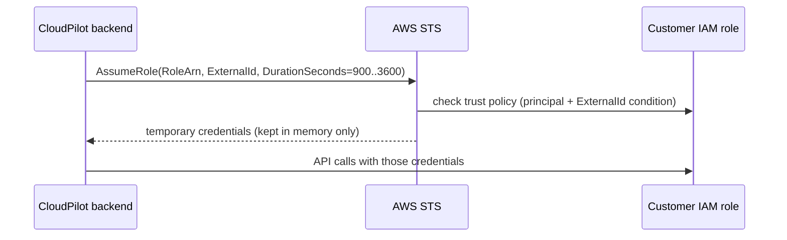

# 08 · Security

> CloudPilot touches **source code** and **customers' AWS accounts**. A security mistake here is the product's biggest risk.
> ✅ = implemented · 📋 = stated in README / AI brief · 💡 = proposed here (review before adopting).

## 1. Security principles

1. **Least privilege.** Planning is read-only; deploying uses a *separate*, scoped, short-lived role.
2. **Human gate.** No LLM ever authorizes an AWS action (`AI brief §5`). Every apply has a recorded `approvals` row.
3. **Never trust the repository.** Its contents are untrusted *data*: parsed, never executed, never obeyed as instructions.
4. **Never store what you can't protect.** No source code, no AWS keys, no GitHub OAuth tokens, no Terraform state in PostgreSQL.
5. **Defense in depth.** Every important rule is enforced twice (DB constraint **and** app check; Pydantic **and** prompt).
6. **Everything sensitive is auditable** (`audit_logs` 💡, `approvals`, `deployment_steps`, `agent_runs`).

## 2. Authentication ✅

| Item | Implementation |
|---|---|
| Identity | GitHub OAuth, scope `read:user user:email` **only** |
| CSRF on OAuth | random `state` → HttpOnly cookie `oauth_state` (10 min) → `compare_digest` |
| OAuth token | used once to fetch the profile, **not stored** |
| Session | JWT in HttpOnly cookie `access_token` (or `Authorization: Bearer`); 30 min; claims `sub`/`iat`/`exp` only |
| JWT hardening | algorithm pinned (no `alg:none`), `exp` and `sub` required, signature verified, tests for tampering/expiry |
| Cookie flags | `HttpOnly`, `SameSite=Lax`, `Secure` outside `ENVIRONMENT=development` |
| `dev-login` | exists only when `ENVIRONMENT=development` (404 otherwise, test-covered) |

Gaps (see `01` §6): **I5** no team authorization yet · **I6** no `Origin` check · **I12** no JWT-secret min length · **I13** free-string environment.

## 3. Authorization 📋

- `require_team_role(min_role)` dependency: reads `team_members.role` **from the DB on every request** (roles can change while a token is valid).
- Role matrix: `03` §4. Default deny: an endpoint without an explicit role check is a bug.
- **Tenant isolation:** every query on a team-owned entity must be scoped by the caller's team membership. Use one helper (`get_project_for_user(db, user, project_id, min_role)`) so no router builds its own query. Return **404, not 403**, for objects of other teams (no existence leak).
- 💡 Test: for each endpoint, a user from team B gets 404 on team A's resource (parametrized "IDOR" test).
- Plan limits (`plans.limits`) are enforced in services, not routers.

## 4. GitHub access model

| Stage | Mechanism | Scope |
|---|---|---|
| Sign in | OAuth App ✅ | identity only; **no repo access** |
| Repo access | **GitHub App installation** 📋 | `Contents: read`, `Metadata: read`, (`Webhooks`/push event). No write permissions in MVP |
| Runtime | installation access tokens (≈1 h, minted on demand) 📋 | resolved **inside the Communication Module**; never reach agent prompts or logs |
| Webhooks | `POST /webhooks/github` | verify `X-Hub-Signature-256` HMAC with constant-time compare; reject if missing; idempotent on `delivery id` + `(repository_id, sha)` |

The GitHub App private key lives in a secret manager / env, never in the repo or DB.

## 5. AWS access model (customer accounts) 📋💡



| Rule | Why |
|---|---|
| **No access keys, ever.** No IAM users for people or for CloudPilot. | nothing long-lived to leak |
| **External ID** per `aws_accounts` row (random, ≥ 32 chars, unique, generated by CloudPilot, **not** chosen by the customer) | prevents the *confused-deputy* attack: another CloudPilot customer cannot make us assume *your* role |
| **Two roles** (ADR-010): `cloudpilot-readonly` (planning/discovery) and `cloudpilot-deploy` (apply) | planning can never mutate; deploy role is only assumed by the deployment worker after an approval |
| Short sessions (15–60 min), re-assume per job | limits blast radius |
| Deploy role scoped: allowed services/regions, **permissions boundary**, resources tagged `ManagedBy=CloudPilot`, no `iam:*` on arbitrary roles | a stolen session cannot take over the account |
| Verify on connect (`AssumeRole` + `sts:GetCallerIdentity`) and re-verify periodically | detect broken/removed roles |
| Disconnecting sets `status=DISCONNECTED`, the row stays | audit |

Trust policy template to show the customer (account id and external id are filled by CloudPilot):

```json
{
  "Version": "2012-10-17",
  "Statement": [{
    "Effect": "Allow",
    "Principal": { "AWS": "arn:aws:iam::<CLOUDPILOT_ACCOUNT_ID>:role/cloudpilot-backend" },
    "Action": "sts:AssumeRole",
    "Condition": { "StringEquals": { "sts:ExternalId": "<EXTERNAL_ID>" } }
  }]
}
```

Provide the role as a **CloudFormation/Terraform snippet** the customer reviews and applies themselves. The permission policy must be shown in full before connecting (transparency builds trust).

## 6. Untrusted repository & prompt-injection rules (AI layer)

| Threat | Control |
|---|---|
| Malicious code in the repo | **never** run install scripts, tests, builds, `import`, `eval`; parse text only. No network or shell tools for agents |
| Zip-bomb / huge repos / path tricks | limits on files, bytes per file, total bytes, wall-clock; use the GitHub Trees/Contents API (no `git clone` + checkout hooks); reject symlinks and `..` paths |
| Prompt injection inside files/README/comments | system prompt: repo text is *data*; LLM has **no tools** except "return JSON"; output must validate against the Pydantic schema; excerpts are length-capped; deterministic detectors run first so the LLM cannot override facts it did not need |
| Secrets committed in the repo | detect by pattern, report **path + kind only**, redact before prompt; never include source excerpts in reports, API responses, persistence, or logs; add `SECRET_COMMITTED` finding |
| Model output trusted blindly | treat as untrusted: Pydantic validation, one repair attempt, then fail |
| Cost abuse (token flooding) | max prompt size, per-team rate limit, `agent_runs.usage` accounting |
| LLM provider data exposure | send only redacted excerpts transiently; do not persist or return excerpts; document provider and retention (Q-2) |

## 7. Secrets & data handling

| Data | Rule |
|---|---|
| `JWT_SECRET_KEY`, GitHub client secret, GitHub App key, LLM key | env/secret manager only; startup fails if missing ✅; 💡 JWT secret ≥ 32 chars |
| AWS temporary credentials | memory only, never logged, never persisted |
| Terraform state | customer's own S3 bucket + DynamoDB lock (ADR-013), never PostgreSQL |
| Terraform plan output | store a **summary**; scrub sensitive values (`sensitive = true`) |
| Logs | JSON; **never** log `Authorization`, cookies, tokens, repo content, env values, full prompts. Use an allow-list logger for `agent_runs` |
| PII | only GitHub id, name, email, avatar. Provide deletion/anonymization path for `users` 💡 |
| Backups | encrypted at rest; restore tested (09) |

## 8. Web/API hardening

| Control | Status |
|---|---|
| CORS exact origin + `allow_credentials` | ✅ |
| Security headers (`X-Content-Type-Options`, `Referrer-Policy`, HSTS in prod) | 💡 |
| `Origin` check on state-changing requests (CSRF) | 💡 **I6** |
| Rate limiting (login, job creation, webhooks) | 💡 simple per-user/IP limiter, then gateway |
| Input bounds (page size ≤ 100, body size limit) | 💡 |
| Idempotency-Key on job-creating POSTs | 💡 |
| Dependency audit (`pip-audit`) in CI | ✅ |
| Container runs as non-root, read-only FS where possible | 💡 verify Dockerfile |
| Error messages never leak stack traces / SQL | 💡 error envelope (I4) |

## 9. Terraform runner isolation (Phase 2) 💡

Terraform executes provider code and can run arbitrary `local-exec`. Rules:

1. Run **only CloudPilot-generated** Terraform (from the validated `ArchitecturePlan`), never user-supplied `.tf`.
2. Pin provider versions + lockfile; forbid `local-exec`/`external` providers by a static check on generated files.
3. Run in an **ephemeral, isolated container** (no host mounts, no access to the CloudPilot DB, egress limited to AWS + registry), one per deployment, destroyed after.
4. Inject credentials via short-lived env from the deploy role; never write them to disk.
5. Always `plan` → show summary → **human approval** → `apply`. The approved plan file is the one applied.

## 10. Threat list (STRIDE-style)

| # | Threat | Likelihood | Impact | Mitigation | Status |
|---|---|:-:|:-:|---|:-:|
| T1 | Stolen JWT / XSS reads token | L | H | HttpOnly cookie, short expiry, CSP on frontend | ✅/💡 |
| T2 | CSRF state-changing request | M | M | SameSite=Lax + Origin check | 💡 |
| T3 | IDOR: user reads other team's project | M | H | central scoped getters + tests | 📋 |
| T4 | Privilege escalation (MEMBER approves deploy) | M | H | `require_team_role`, DB-read role | 📋 |
| T5 | Confused deputy on AssumeRole | M | **Critical** | unique server-generated External ID | 💡 |
| T6 | Leaked GitHub App key | L | H | secret manager, rotation, minimal perms | 💡 |
| T7 | Forged webhook | M | M | HMAC verify, replay guard | 📋 |
| T8 | Prompt injection steers analysis | H | M | data-only prompts, schema validation, no tools | 💡 |
| T9 | Malicious repo executes code on our servers | L | **Critical** | never execute; text parsing only; isolated worker | 📋 |
| T10 | LLM proposes destructive AWS change | M | **Critical** | `requires_human_approval: Literal[True]`, approvals, deploy role only after approval | ✅(contract)/📋 |
| T11 | Secrets leak via logs/prompts | M | H | redaction at Comm. Module, log allow-list | 📋 |
| T12 | Concurrent deployments corrupt state | M | H | partial unique index per project, remote state lock | 💡 |
| T13 | Terraform `local-exec` abuse | L | H | generated-only TF, static check, sandbox | 💡 |
| T14 | Cost abuse / DoS via analyses | M | M | quotas, rate limit, size limits | 💡 |
| T15 | Supply-chain (deps, base image) | M | M | pip-audit, pinned deps, image scan | ✅/💡 |
| T16 | Audit tampering | L | M | append-only tables, no UPDATE grants for app role on audit | 💡 |

## 11. Security acceptance checklist (before the first real customer AWS account)

- [ ] `require_team_role` + IDOR tests on every team-scoped endpoint
- [ ] Origin check, security headers, rate limits
- [ ] GitHub App with read-only permissions; webhook HMAC test
- [ ] External ID unique + trust-policy template reviewed by someone outside the team
- [ ] Read-only and deploy roles separated; deploy role has permissions boundary
- [ ] Approval row required (DB-checked) before `TERRAFORM_APPLY`
- [ ] Log-redaction test: secrets planted in a fixture repo never appear in logs, prompts, DB
- [ ] Prompt-injection fixture repo (README says "ignore previous instructions...") yields a normal report
- [ ] Terraform runs in an ephemeral sandbox; no `local-exec`
- [ ] Backup restore drill done
