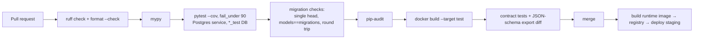

# 09 · DevOps & Deployment

> ✅ = exists today · 📋 = referenced by the README but **not seen** (CI workflows, root README, frontend, AI layer) · 💡 = proposed.
> This file separates two questions: **(A)** how the team builds CloudPilot, **(B)** how CloudPilot deploys customers' apps (that's `07` §6).

## 1. Local environment ✅

```bash
cd backend
python -m venv .venv && source .venv/bin/activate
pip install -r requirements-dev.txt
docker compose -f db.yml up -d                  # postgres:16, container cloudpilot-db, :5432
cp .env.example .env                            # JWT_SECRET_KEY + GitHub OAuth values
alembic upgrade head && python -m app.db.seed
uvicorn app.main:app --reload                   # :8000/docs
docker exec -it cloudpilot-db psql -U cloudpilot -c "CREATE DATABASE cloudpilot_test;"   # once
pytest --cov
```

Gotchas from the README: use `localhost` everywhere (cookies are host-bound); `FRONTEND_URL` must equal the frontend origin with no trailing slash; the app refuses to start when a required variable is missing.

## 2. Configuration

| Variable | Notes | Prod rule |
|---|---|---|
| `DATABASE_URL` | SQLAlchemy URL | managed PG, TLS |
| `ENVIRONMENT` | `development` enables dev-login and non-Secure cookies | 💡 `Literal[development,test,staging,production]` |
| `JWT_SECRET_KEY`, `JWT_ALGORITHM`, `ACCESS_TOKEN_EXPIRE_MINUTES` | HS256, 30 | secret manager; ≥ 32 chars |
| `FRONTEND_URL` | CORS + redirects | exact origin |
| `GITHUB_CLIENT_ID/SECRET/REDIRECT_URI` | OAuth sign-in | |
| 💡 `GITHUB_APP_ID`, `GITHUB_APP_PRIVATE_KEY`, `GITHUB_WEBHOOK_SECRET` | repo access | secret manager |
| 💡 `LLM_PROVIDER`, `LLM_API_KEY`, `LLM_MODEL` | AI layer | secret manager |
| 💡 `AWS_BACKEND_ROLE_ARN` (+ region) | principal that calls `AssumeRole` | instance/task role, no keys |
| 💡 `WORKER_*` (poll interval, job timeout, heartbeat) | worker | |

Rule: **no defaults for secrets**; `.env.example` lists every key with a dummy value; `.env` is git-ignored (verify the root `.gitignore` — issue **I1**).

## 3. Repository hygiene (fix first) 💡

| Item | Action |
|---|---|
| `.gitignore` is 0 bytes in `backend/` (I1) | root or backend ignore for `.env`, `.venv/`, `pgdata/`, `__pycache__/`, `.mypy_cache/`, `.ruff_cache/`, `.pytest_cache/`, `htmlcov/` |
| Line endings mixed (I3) | `.gitattributes`: `* text=auto eol=lf`; normalize in one commit |
| Stray unpinned `pyjwt`/`httpx` in `requirements.txt` (I2) | delete the two lines |
| Dockerfile mentions `docker-compose.test.yml` (I10) | add the file or fix the comment |
| Monorepo layout | 💡 `backend/ ai/ frontend/ contracts/ project_context/ ruff.toml` with path-filtered CI |

## 4. Docker ✅/💡

Existing: multi-stage `Dockerfile` (`base` / `test` / `runtime`). Proposed full-stack compose for local dev and demo:

```yaml
# docker-compose.yml (proposal)
services:
  db:
    image: postgres:16
    environment: { POSTGRES_USER: cloudpilot, POSTGRES_PASSWORD: cloudpilot, POSTGRES_DB: cloudpilot }
    volumes: [ "pgdata:/var/lib/postgresql/data" ]
    healthcheck: { test: ["CMD-SHELL", "pg_isready -U cloudpilot"], interval: 5s, retries: 10 }
  api:
    build: { context: ./backend, target: runtime }
    env_file: ./backend/.env
    depends_on: { db: { condition: service_healthy } }
    command: sh -c "alembic upgrade head && uvicorn app.main:app --host 0.0.0.0 --port 8000"
    ports: [ "8000:8000" ]
  worker:                       # same image, different command (see 03 §7)
    build: { context: ./backend, target: runtime }
    env_file: ./backend/.env
    depends_on: { db: { condition: service_healthy } }
    command: python -m app.jobs.worker
volumes: { pgdata: {} }
```

Runtime image rules: non-root user, no dev dependencies, `HEALTHCHECK` on `/health/live`, pinned base digest, image scan in CI.
Migrations: in a real environment run `alembic upgrade head` as a **separate one-off step** before rolling out the new API version, not inside every replica's start command.

## 5. Continuous integration 📋 (workflows not seen) → proposed pipeline 💡

The README says CI enforces: Ruff lint + format, mypy, pytest-cov (≥ 90 %), pip-audit, Docker `test` stage, migration checks.



💡 Add: **contract-package tests** (valid/invalid fixtures), **OpenAPI diff** check (frontend client regenerates), **secret scanning** (gitleaks), **image scan** (Trivy), path filters so `ai/` and `backend/` pipelines run independently.

## 6. Environments 💡

| Env | Purpose | Data | AWS |
|---|---|---|---|
| local | development | seed data | none (mock STS/GitHub with fakes) |
| CI | tests | ephemeral `*_test` DB | none |
| staging | demo rehearsal, integration with **real GitHub App + a sandbox AWS account** | fake teams | dedicated sandbox account(s) |
| production | graduation demo / pilot users | real | customers' accounts via roles |

Never point staging at production DB or production GitHub App. Use separate GitHub OAuth apps per environment (the redirect URI differs).

## 7. How CloudPilot itself ships (demo topology) 💡

Frontend `app.<domain>` and API `api.<domain>` share the **parent domain** (cookie must not be third-party).

| Option | Pros | Cons | Use when |
|---|---|---|---|
| **A. One EC2/VM + Docker Compose** (api, worker, reverse proxy with TLS; RDS or compose PG) | cheapest, simplest to debug | single point of failure | graduation demo |
| **B. ECS Fargate (api + worker services) + RDS + ALB** | closer to what CloudPilot recommends to customers ("eat your own dog food") | more setup/cost | pilot, if time allows |

Dogfooding is a strong demo: **deploy CloudPilot's own backend with CloudPilot** (it is also the first golden fixture for the Analysis Agent).

Release flow: PR → CI green → merge to `main` → build image tagged with git SHA → push registry → run migrations → roll API + worker → smoke test `/health/ready` → rollback = redeploy previous SHA (migrations must be backward compatible for one release: add columns nullable first, drop later).

## 8. Observability 💡

| Signal | Plan |
|---|---|
| Logs | JSON to stdout; fields `ts, level, msg, correlation_id, user_id, team_id, job_id`; shipped to CloudWatch/Loki; redaction filter |
| Metrics | request rate/latency/errors; job queue depth, job duration by outcome, LLM latency/tokens/cost, GitHub rate-limit remaining |
| Traces | optional OpenTelemetry; `correlation_id` is the minimum |
| Health | `/health/live` (process up), `/health/ready` (DB reachable, migrations at head), `/health/db` ✅ |
| Alerts | error-rate spike, stuck `RUNNING` jobs (heartbeat stale), queue age > N min, DB connections |

## 9. Backups & disaster recovery 💡

PG automated backups + PITR (RDS) or nightly `pg_dump` for the demo; **practice a restore once**. History tables are the product — losing `deployments`/`approvals` is unacceptable. Terraform state is in the customer's bucket, so CloudPilot DB loss does not orphan customer infrastructure.

## 10. Definition of done for any backend change

Ruff clean · mypy clean · tests added and ≥ 90 % coverage · migration generated, reviewed, round-trips · docs in `project_context/` updated in the same PR (README table) · no secrets in diff · error paths return the envelope.
