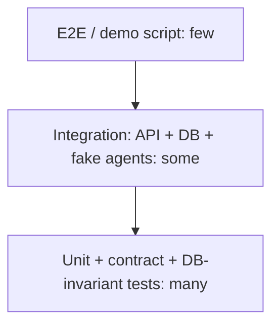

# 10 · Testing Strategy

> ✅ = exists (41 tests) · 📋 = to add with the matching module · 💡 = proposed.

## 1. Principles

1. **Test behavior at the boundary you own**: HTTP for routers, service functions for business rules, schemas for contracts.
2. **Real PostgreSQL, not SQLite** — partial unique indexes, `CHECK`, JSONB and `SKIP LOCKED` behave differently elsewhere ✅ (already the case).
3. **No network in tests.** GitHub, AWS and the LLM are replaced by fakes behind the `Protocol`s (`03` §1, `06` §6). A test that needs the internet is a bug.
4. **Contracts first.** A change to `ai_contracts.py` must come with valid *and* invalid fixtures.
5. **Every invariant in `04` §5 has a test** that tries to break it.
6. **Security properties are tests**, not intentions (`08` §11).

## 2. Pyramid



| Layer | Scope | Tools | Speed target |
|---|---|---|---|
| Unit | pure functions: detectors, parsers, cost calculator, state-machine guards, JWT | pytest | ms |
| Contract | Pydantic models: valid/invalid fixtures, JSON-schema snapshot | pytest | ms |
| DB-invariant | constraints and indexes against real PG | pytest + savepoint rollback ✅ | ~10 ms |
| Service | business rules with a DB session and fake integrations | pytest | ~50 ms |
| API | FastAPI `TestClient`, auth, authorization, envelope | pytest ✅ | ~50 ms |
| Orchestrator | graph paths with a **fake Analysis Agent** | pytest (+ LangGraph) | ~100 ms |
| Golden-repo | Analysis Agent on fixture repos → expected `AnalysisReport` | pytest | ~1 s |
| E2E | frontend → API → worker → fake GitHub → DB | Playwright (frontend team) | slow, nightly |

## 3. What exists today ✅ (41 tests, gate `fail_under = 90`)

`test_auth_api` 17 · `test_security` 8 · `test_github_integration` 6 · `test_auth_service` 5 · `test_migrations` 3 · `test_seed` 2. Isolation: settings forced before importing `app`; **refuses a DB not ending in `_test`**; migrate once per session; each test in a rolled-back savepoint. Keep this harness; every new test file reuses it.

## 4. What to add per module 📋

| Module / area | Must-have tests |
|---|---|
| **Personal team on first login** | first login creates team + OWNER member + FREE subscription in **one transaction**; second login creates nothing; failure rolls everything back; concurrent first login (I7) doesn't 500 |
| **`require_team_role`** | each role × each protected action; role changed in DB takes effect with the same token; non-member → 404 |
| **Tenant isolation (IDOR)** | parametrized over every team-scoped route: user of team B gets 404 on team A resources |
| **projects** | create enforces `max_projects`; archive instead of delete; archived project rejects new analyses |
| **repositories** | one deployment branch (service + DB), idempotent commit insert, same repo in two projects behaves per decision Q-3 |
| **webhooks** | valid HMAC accepted, missing/invalid rejected, replay is a no-op |
| **analysis API** | `POST` → 202 + QUEUED row; unknown commit → 404; `GET` of other team's analysis → 404; polling returns terminal states; `answers` creates a new analysis |
| **worker / jobs** | claim is exclusive (two workers, one job), heartbeat, stale sweeper → `TIMED_OUT`/re-queue, crash mid-job leaves no `RUNNING` forever |
| **architectures** | version numbers never collide under concurrency; edit = new version; approved version immutable; only validated non-blocked analysis can generate |
| **aws_accounts** | external ID unique and server-generated; verify success/failure paths with a fake STS; no credential ever persisted (assert on DB dump) |
| **deployments** | 409 when one is active; cannot start with a non-APPROVED version; **cannot reach `TERRAFORM_APPLY` without an `approvals` row**; step order unique |
| **incidents/healing** | HIGH-risk action never auto-executes; approval unique per action; exactly-one-subject CHECK |
| **error envelope** | every error type returns `{error:{code,message,correlation_id}}`; no stack traces |
| **migrations** ✅ | keep: single head, models == migrations, round trip. 💡 add: `schema-full.sql` applies cleanly to an empty PG 16 and yields the same table names as `alembic upgrade head` once all migrations exist |

### Example: DB-invariant tests 💡 (sketch; mirror what was manually verified against PG 16 when drafting `schema-full.sql`)

```python
import pytest
from sqlalchemy.exc import IntegrityError

def test_only_one_deployment_branch_per_repository(db, repo_factory, branch_factory):
    repo = repo_factory()
    branch_factory(repository=repo, name="main", is_deployment_branch=True)
    with pytest.raises(IntegrityError):
        branch_factory(repository=repo, name="dev", is_deployment_branch=True)
        db.flush()

def test_approval_requires_exactly_one_subject(db, user_factory):
    from app.models import Approval
    with pytest.raises(IntegrityError):
        db.add(Approval(requested_by=user_factory().id))   # no healing_action, no deployment
        db.flush()

def test_projects_cannot_be_deleted_when_referenced(db, repo_factory):
    repo = repo_factory()
    with pytest.raises(IntegrityError):
        db.delete(repo.project)
        db.flush()
```

## 5. AI-layer testing 💡

| Test kind | What | Why |
|---|---|---|
| **Contract tests** | valid fixtures pass; each invalid fixture fails with the expected message (bad confidence, `extra` field, `requires_human_approval=False`, secret-looking env var value, cost sum mismatch, unknown component dependency) | the contract *is* the integration boundary |
| **Fake agents** | `FakeAnalysisAgent` returns scripted `AgentResult`s (ok, blocked, invalid, slow, raising) | orchestrator is tested **without any LLM** |
| **Orchestrator paths** | success · blocked (blockers / required info / unsupported) · agent error non-retryable · retryable then success · retries exhausted · invalid output → one repair → fail · stage timeout · job timeout · persistence failure · cancellation | the brief's Phase 5 list: *successful paths, unsupported repos, API failures, invalid outputs, timeouts* |
| **Golden repositories** | small fixture repos in `tests/fixtures/repos/`: FastAPI+PG, Express+Mongo, Next.js static, Java Spring, Go, monorepo (2 services), no-Dockerfile, no-start-command, SQLite-only, secret-committed, prompt-injection README | deterministic detectors get exact assertions; LLM-assisted fields get tolerance (e.g. confidence ≥ x) |
| **Determinism** | detectors are pure: same input → same output; LLM calls recorded/replayed (VCR-style cassettes) in CI, real LLM only in a nightly job | stable, cheap CI |
| **Safety tests** | prompt-injection fixture produces a normal report; planted secret never appears in logs/prompts/DB; repo with a malicious `setup.py`/`postinstall` is only *read*; limits set `meta.truncated=true` | `08` §6 |
| **Evaluation set (Phase 4 research)** | 20–30 real open-source repos with hand-labelled ground truth → precision/recall of languages, frameworks, services, blockers | the README's "analysis accuracy" metric |

The backend's own repo is the first golden fixture (the example in `contracts/ai-contracts.md` §3).

## 6. Deployment-path testing (Phase 2) 💡

- Generated Terraform: `terraform validate` + `tflint` + policy checks (no `local-exec`, no `0.0.0.0/0` on DB ports) in CI.
- Deploy to a **sandbox AWS account** in a nightly job; always `destroy` after; budget alarm on the account.
- Failure injection: deny a permission, fail at each `step_type`, check `deployment_steps` shows the failing step and status becomes `FAILED`.

## 7. Conventions

- One behavior per test; name `test_<unit>_<condition>_<expected>`.
- Factories (`user_factory`, `team_factory`, `repo_factory`…) in `tests/factories.py`; avoid giant fixtures.
- Freeze time (`freezegun`/injected clock) for expiry and timeouts.
- Coverage gate stays ≥ 90 %; new modules must not lower it. Don't chase 100 %: prefer testing invariants over lines.
- Flaky test = defect; quarantine within a day, fix within a week.
