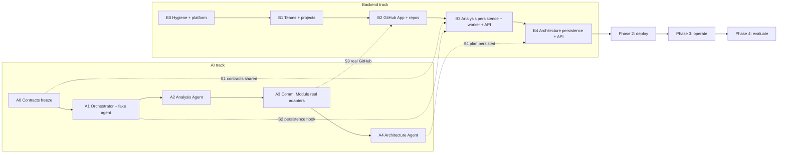

# 11 · Implementation Roadmap

> Merges the **backend README roadmap** (Phases 1–4) with the **AI brief's six phases** into one dependency-ordered plan.
> Sizes: **S** ≤ 1 day · **M** 2–4 days · **L** ≈ 1–2 weeks (one person). They are relative estimates to plan with, not commitments.
> Tick a task here **in the same PR** that finishes it, then update `01-current-state.md`.

## 1. Two tracks, four sync points

The AI team does **not** need to wait for the backend: contracts, the orchestrator (with a fake agent) and the Analysis Agent can be built and tested in isolation. They meet the backend at the sync points.

| Sync | What must be agreed/ready | Who |
|---|---|---|
| **S1** | `ai_contracts.py` v1.0 frozen, package location (ADR-009/018) | both |
| **S2** | persistence hook events (`06` §7) ↔ M2/M3 migrations | both |
| **S3** | GitHub App installation token available to the Comm. Module | backend → AI |
| **S4** | `ArchitecturePlan` → `architecture_versions` + `cost_estimates` | both |

## 2. Backend track

### B0 · Hygiene & platform (do first, ~1 week)
| ID | Task | Depends | Size | Done when |
|---|---|---|:-:|---|
| B0.1 | Fix `.gitignore` (I1), `.gitattributes` + normalize EOL (I3), delete stray `pyjwt`/`httpx` lines (I2), fix Dockerfile comment (I10) | – | S | clean `git status` on a fresh clone; `pip-audit` meaningful |
| B0.2 | Settings hardening: `Literal` environment, JWT secret ≥ 32 (I12, I13) | – | S | tests for bad values |
| B0.3 | `core/errors.py`: domain exceptions + error envelope + handlers (I4, ADR-017) | – | M | all errors return envelope; test per exception |
| B0.4 | `core/logging.py` + `X-Request-ID` middleware (correlation id) | B0.3 | M | JSON logs, id in response header, redaction test |
| B0.5 | Origin/CSRF middleware (I6), security headers | – | S | cross-origin POST rejected (test) |
| B0.6 | `/health/live`, `/health/ready` (I9) | – | S | |
| B0.7 | Race-safe `upsert_github_user` (I7) | – | S | concurrent-login test |
| B0.8 | Pagination helper + shared `Page[T]` schema | – | S | |
| B0.9 | Create the shared contracts package from `contracts/ai_contracts.py`; CI runs it | – | S | `python ai_contracts.py` + pytest in CI |
| B0.10 | Migration **M8 `audit_logs`** early + `audit.record()` helper | B0.3 | S | used by first team endpoints |

### B1 · Teams, authorization, projects (~1–2 weeks)
| ID | Task | Depends | Size | Done when |
|---|---|---|:-:|---|
| B1.1 | **Personal team on first login**: team + OWNER member + FREE subscription in one transaction | B0.7 | M | new user can immediately create a project |
| B1.2 | `require_team_role` + tenant-scoped getters (`08` §3) | B1.1 | M | role matrix tests + IDOR tests |
| B1.3 | `teams` module: list/get/rename, members add/role/remove, last-OWNER guard | B1.2 | M | |
| B1.4 | `billing`: current plan, usage vs `limits`, `PLAN_LIMIT_REACHED` | B1.2 | S | |
| B1.5 | `projects` module: CRUD, archive, quota | B1.4 | M | archived project rejects new work |
| B1.6 | Seeds extended (analysis/architecture samples later) | B1.5 | S | frontend can build screens |

### B2 · Repositories & GitHub App (~1–2 weeks)
| ID | Task | Depends | Size | Done when |
|---|---|---|:-:|---|
| B2.1 | Register GitHub App (read-only) + `integrations/github_app.py`: JWT → installation token, list repos/branches/trees/contents | B1.5 | M | fake + one real smoke test in staging |
| B2.2 | `repositories` module: connect repo (metadata only), branches sync, **set deployment branch** | B2.1 | M | partial-unique-index test + service test |
| B2.3 | Webhook `/webhooks/github`: HMAC, push on deployment branch → `commits` (idempotent) | B2.2 | M | forged/replayed webhook tests |
| B2.4 | Decide Q-3 (`github_repository_id` scope) and align model/ERD | – | S | ADR/Q closed |

### B3 · Analysis persistence, worker, API (needs S1+S2) (~2 weeks)
| ID | Task | Depends | Size | Done when |
|---|---|---|:-:|---|
| B3.1 | **Migration M2** `repository_analyses` (with P3/P4/P5 changes), `services` | B2.2 | M | migration gates green |
| B3.2 | **Migration M3** `agent_runs`, `agent_tasks` (plain `deployment_id`/`incident_id`, ADR-012) | B3.1 | S | |
| B3.3 | `jobs/` worker: claim `SKIP LOCKED`, heartbeat, sweeper, graceful shutdown (ADR-008) | B3.1 | L | exclusivity + stale-job tests |
| B3.4 | Persistence hook implementing `06` §7 events | B3.2, A1 | M | state changes visible in DB |
| B3.5 | `analysis` module: `POST` 202, `GET`, history, services, cancel, answers | B3.3 | M | `05` §3.4 examples pass |
| B3.6 | Idempotency-Key + per-team rate limit on job creation | B3.5 | S | |

### B4 · Architecture persistence & API (needs A4) (~1–2 weeks)
| ID | Task | Depends | Size | Done when |
|---|---|---|:-:|---|
| B4.1 | **Migration M4** `architectures`, `architecture_versions`, `cost_estimates` | B3.1 | M | |
| B4.2 | `architectures` module: generate (202), list, versions, edit → new version, validate, approve | B4.1, A4 | L | version numbers race-safe; approved = immutable |
| B4.3 | Rule-based validator (completeness, security rules, dependency graph) | A0 | M | unit tests |
| B4.4 | Cost estimate recompute endpoint | B4.1 | S | |

## 3. AI track

### A0 · Design & contracts (AI brief Phase 1) (~3–5 days)
| ID | Task | Depends | Size | Done when |
|---|---|---|:-:|---|
| A0.1 | Review & freeze `ai_contracts.py` v1.0 with backend (S1) | – | S | checklist in `contracts/ai-contracts.md` §7 ticked |
| A0.2 | Boundary doc: inputs/outputs/never-do per component (`06` §1) accepted | – | S | |
| A0.3 | Failure-state map accepted (`06` §3.6); timeouts table tuned | – | S | |
| A0.4 | Decide Q-1 (package location), Q-2 (LLM provider), Q-5 (AWS discovery) | – | S | ADRs accepted |

### A1 · Orchestrator foundation (Phase 2) (~1–2 weeks)
| ID | Task | Depends | Size | Done when |
|---|---|---|:-:|---|
| A1.1 | `FakeAnalysisAgent` + `FakeCommunicationModule` (scripted results/errors/delays) | A0 | S | |
| A1.2 | LangGraph pipeline (analysis-only): mark running → analyze ‖ discover → validate/combine → evaluate → save | A1.1 | L | graph runs end-to-end with fakes |
| A1.3 | Timeouts, retries, 1 repair attempt, cancellation | A1.2 | M | all paths in `10` §5 pass |
| A1.4 | Strict output validation + `is_deployable` gate; state-change events | A1.2 | M | invalid output → `FAILED`, blockers → `BLOCKED` |
| A1.5 | Lint rule/test: **zero repository-inspection code in orchestrator** | A1.2 | S | import-linter or grep test |

### A2 · Analysis Agent (Phase 3) (~3–4 weeks, the biggest AI item)
| ID | Task | Depends | Size | Done when |
|---|---|---|:-:|---|
| A2.1 | Golden fixture repos (see `10` §5) incl. injection + secret + monorepo cases | A0 | M | fixtures + expected reports committed |
| A2.2 | Tree listing + file filter + limits (`truncated`) via an interface (fake GitHub in tests) | A1.1 | M | |
| A2.3 | Deterministic detectors: Python, Node, Java/Gradle/Maven, Go; Dockerfile, compose, CI, Terraform, `.env.example` | A2.1 | L | exact assertions on fixtures |
| A2.4 | Service/entry-point/port/health detection; monorepo splitting | A2.3 | M | |
| A2.5 | Blocker/warning/unsupported/missing-info rules (`06` §4.3) | A2.4 | M | |
| A2.6 | LLM-assisted resolution for ambiguity on redacted excerpts; one-repair JSON loop; prompt-injection defenses | A2.4 | L | injection fixture yields normal report |
| A2.7 | Secret detection + redaction utility (shared with Comm. Module) | – | M | planted secrets never leave the module |
| A2.8 | Assemble `AnalysisReport` with evidence + confidence | A2.5 | M | validates on every fixture |

### A3 · Communication Module (Phase 4)
| ID | Task | Depends | Size | Done when |
|---|---|---|:-:|---|
| A3.1 | `CommunicationModule` Protocol + in-process implementation | A1 | S | |
| A3.2 | GitHub adapter (installation-token resolution, rate-limit handling, error normalization) | B2.1 | M | `GITHUB_*` codes map correctly |
| A3.3 | LLM adapter (timeouts, usage accounting, error normalization) | A0.4 | M | `agent_runs.usage` filled |
| A3.4 | AWS read-only discovery adapter (optional, Q-5) | B-aws | M | non-fatal on failure |
| **Milestone ★ MVP-1** | **Submit a repo → job → persisted `AnalysisReport` / `BLOCKED` retrievable via API** | B3, A2, A3 | | demo script (§6) |

### A4 · Architecture Agent (Phase 5)
| ID | Task | Depends | Size | Done when |
|---|---|---|:-:|---|
| A4.1 | Pattern catalog: static site, single container + RDS, API + worker, serverless — mapped from `AnalysisReport` | MVP-1 | M | |
| A4.2 | Deterministic cost table by region/size; optional Pricing API; `pricing_as_of` | – | M | sums validate |
| A4.3 | LLM-assisted selection + assumptions + security design; plan validation (`ArchitecturePlan` + rules) | A4.1 | L | `requires_human_approval` always true |
| A4.4 | Add `architect` nodes to the graph; integration tests: success, unsupported repo, API failure, invalid output, timeout (brief Phase 5) | A4.3 | M | all five pass |
| **Milestone ★ MVP-2** | **Analysis → blocked/OK → ArchitecturePlan persisted as `architecture_versions` + `cost_estimates`** | B4, A4 | | demo script |

## 4. Phase 2 — Edit, approve, deploy (after MVP-2)

Maps to README Phase 2 and brief Phase 6 ("prepare for deployment MVP").

| ID | Task | Depends | Size |
|---|---|---|:-:|
| D0 | Boundary doc: read-only vs write capabilities (`02` §3) accepted; **gap list of AWS APIs/permissions** needed for deploy | MVP-2 | S |
| D1 | **M5** migration: `aws_accounts` (+`external_id`, two ARNs), `deployments`, `deployment_steps`, `infrastructure_resources`; add `agent_runs.deployment_id` FK; active-deployment unique index | MVP-2 | M |
| D2 | `aws_accounts` module: create + External ID + role template, verify via STS (fake STS in tests) | D1 | M |
| D3 | `integrations/aws/sts.py`, session factory with short-lived creds | D2 | M |
| D4 | Dockerfile generator from `AnalysisReport` (templates, not free LLM text) | MVP-2 | L |
| D5 | Terraform generator from `ArchitecturePlan` (templates per component type); `validate`/`tflint`/policy checks | MVP-2 | L |
| D6 | Terraform runner: ephemeral sandbox, remote state bootstrap in customer S3 (ADR-013) | D3, D5 | L |
| D7 | `deployments` module + worker steps (`07` §6): create, plan, **approve**, apply, health check, cancel, retry | D1, D6 | L |
| D8 | Approvals generalization (ADR-011) + DB-level guarantee that apply needs an approval | D1 | M |
| D9 | Build/push image step (ECR) | D4, D3 | M |
| D10 | `costs`: import actual cost, compare with estimate | D2 | M |
| ★ **MVP-3** | One real deployment of a demo app into a sandbox AWS account with approval and visible steps | D7 | |

## 5. Phase 3 — Operate & heal (README Phase 3)

M6/M7 migrations (`monitoring_configs`, `alerts`, `cost_records`, `incidents`, `healing_actions`, `approvals`+`agent_runs.incident_id` FK) → monitoring configuration and alert ingestion → incident creation → **Diagnosis Agent** (new contract) → proposed `healing_actions` with `risk_level` → approval flow → executor via deploy role → written **healing policy** (what LOW-risk actions may auto-run; default = require approval).

## 6. Phase 4 — Evaluation & research (README Phase 4)

Labelled corpus of 20–30 repos → analysis precision/recall · deployment success rate (needs `deployments` history) · cost estimate vs actual (`cost_estimates` vs `cost_records`) · manual-baseline comparison (time and errors for a user doing it by hand). Data comes from tables that already exist in the schema (`agent_runs.usage`, `deployments.status`, `cost_*`): another reason to keep history rows.

## 7. Graduation-demo cut line 💡

| Must | Should | Could |
|---|---|---|
| Sign in · team · project · connect repo · analysis · BLOCKED handling with questions · architecture proposal + cost · edit → new version · approve | AWS connect + verify · Dockerfile + Terraform **plan** (no apply) · deployment history UI with steps | real `apply` into a sandbox account · monitoring · one scripted incident with a human-approved fix |

Demo script (MVP-1/2): sign in → "Demo Shop" project → connect `acme/demo-shop` → run analysis → show evidence + confidence → show a second repo that is `BLOCKED` (no start command) with the question flow → generate architecture → show cost → edit (creates v2) → approve.

## 8. Mapping to the AI brief's phases

| Brief phase | Tasks |
|---|---|
| 1 Design the components | A0.1–A0.4 |
| 2 Orchestrator foundation | A1.1–A1.5 |
| 3 Analysis Agent | A2.1–A2.8 |
| 4 Communication & persistence | A3.1–A3.4, B3.1–B3.5 |
| 5 Architecture Agent & tests | A4.1–A4.4, B4.1–B4.4 |
| 6 Prepare the Deployment MVP | D0 (+ D4/D5 design) |

## 9. Critical path & risks to the schedule

`B0.9 → A0.1 → A1 → A2 → A3 → MVP-1` and `B0 → B1 → B2 → B3 → MVP-1`. The longest single item is **A2 (Analysis Agent)**; start fixtures (A2.1) in week 1. Largest schedule risks: GitHub App setup delays (B2.1), LLM output instability (A2.6), Terraform generation scope (D5). See `13`.
