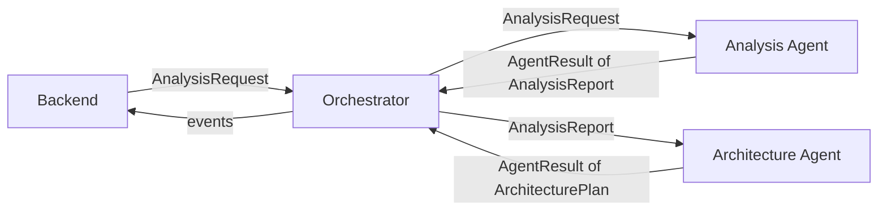

# AI Contracts — AnalysisReport · ArchitecturePlan · Errors

> 💡 **Proposed draft** for Phase 1 of the AI brief ("define the strictly typed `AnalysisReport` schema and standard error formats; agree on the exact data exchange format before writing application logic").
> Code: [`ai_contracts.py`](ai_contracts.py) (Pydantic v2, Python 3.12). It has been **run** (`python ai_contracts.py` self-check) under pydantic 2.14.1, and the example in §3 validates against `AnalysisReport`. Still a draft for the AI and backend teams to review together.

## 1. Where the contracts sit



Put the contracts in **one shared package** imported by both the backend and the AI layer, so there is exactly one definition. (Open question Q‑1.)

## 2. Design rules encoded in the models

| Rule | How |
|---|---|
| Strict validation | every model inherits `Strict` → `extra="forbid"`, `validate_assignment=True` |
| Evidence-backed detections | `Detection` base = `confidence ∈ [0,1]` + up to 10 `Evidence(file_path, lines, short redacted excerpt)` |
| No secrets | `EnvVar` has **name only**; excerpts are capped at 300 chars and must be redacted; error `details` hold only scalar values |
| One of result/error | `AgentResult[T]` validator: `ok=True` ⇒ result and no error; `ok=False` ⇒ error and no result |
| Planning is read-only | `ArchitecturePlan.requires_human_approval: Literal[True]` — an LLM cannot output `false` |
| Versioned | `schema_version: "1.0"` in both documents; `report_schema_version` column proposed on `repository_analyses` |
| Orchestrator gate | `AnalysisReport.is_deployable` ⇒ no blockers, no unsupported tech, no *required* missing info |
| Bounded size | lists and strings have max lengths (`dependencies ≤ 2000`, `summary ≤ 1000`, …) so one repo cannot bloat a JSONB row |

## 3. `AnalysisReport` (field map)

| Field | Type | Maps to | Purpose (brief) |
|---|---|---|---|
| `schema_version` | `"1.0"` | – | evolution |
| `repository` | `RepositoryRef(owner,name,branch,commit_sha[40])` | `repositories`, `commits` | which code was analyzed |
| `summary` | str ≤ 1000 | UI | human summary |
| `languages[]` | `Language(name, version?, share_percent?, +Detection)` | – | **languages** |
| `frameworks[]` | `Framework(name, version?, kind, +Detection)` | – | **frameworks** |
| `services[]` | `DetectedService(name, service_type, language?, framework?, path, port?, has_dockerfile, health_endpoint?, metadata)` | **`services` table** | deployable units |
| `dependencies[]` | `Dependency(ecosystem, name, version_spec?, dev_only, manifest_path)` | – | **package dependencies** |
| `config_files[]` | `ConfigFile(path, kind, +Detection)` | – | **configuration files** |
| `entry_points[]` | `EntryPoint(path, command?, +Detection)` | – | **entry points** (recorded, never executed) |
| `data_stores[]` | `DataStore(engine, inferred_from, +Detection)` | feeds Architecture Agent | DB/cache needs |
| `env_vars[]` | `EnvVar(name, required, referenced_in?)` | – | runtime configuration (names only) |
| `blockers[]` | `Finding(code, severity=BLOCKER, message, evidence, suggested_action)` | – | **deployment blockers** |
| `warnings[]` | `Finding(severity=WARNING/INFO …)` | – | **warnings** |
| `missing_info[]` | `MissingInfo(key, question, required)` | UI questions | **missing info** |
| `unsupported[]` | `UnsupportedTechnology(name, reason)` | – | **unsupported technologies** |
| `overall_confidence` | float 0–1 | – | **confidence scores** |
| `meta` | `AnalysisMeta(analyzer_version, files_scanned/skipped, truncated, duration_ms, model?)` | – | reproducibility |

### Example (abridged; numbers in `meta` are illustrative)

```json
{
  "schema_version": "1.0",
  "repository": { "owner": "acme", "name": "demo-shop", "branch": "main",
                  "commit_sha": "c3d4e5f60718293a4b5c6d7e8f90123456789012" },
  "summary": "FastAPI backend with PostgreSQL and a Dockerfile.",
  "languages": [ { "name": "python", "version": "3.12", "share_percent": 91.0, "confidence": 0.98,
                   "evidence": [ { "file_path": ".python-version", "line_start": 1 } ] } ],
  "frameworks": [ { "name": "fastapi", "version": "0.143.0", "kind": "backend", "confidence": 0.99,
                    "evidence": [ { "file_path": "requirements.txt", "line_start": 7 } ] } ],
  "services": [ { "name": "api", "service_type": "api", "language": "python", "framework": "fastapi",
                  "path": ".", "port": 8000, "has_dockerfile": true, "health_endpoint": "/health/db",
                  "confidence": 0.95, "evidence": [ { "file_path": "Dockerfile" } ] } ],
  "data_stores": [ { "engine": "postgresql", "inferred_from": "psycopg in requirements.txt", "confidence": 0.97 } ],
  "env_vars": [ { "name": "DATABASE_URL", "required": true, "referenced_in": "app/core/config.py" } ],
  "blockers": [],
  "warnings": [ { "code": "NO_LIVENESS_ENDPOINT", "severity": "WARNING", "message": "/health/db needs the database; no pure liveness route." } ],
  "missing_info": [],
  "unsupported": [],
  "overall_confidence": 0.93,
  "meta": { "analyzer_version": "0.1.0", "files_scanned": 84, "files_skipped": 210,
            "truncated": false, "duration_ms": 8120, "model": null }
}
```

> The example describes this very backend, which makes a convenient first golden fixture.

## 4. `ArchitecturePlan` (field map)

| Field | Notes |
|---|---|
| `source_analysis_id` | UUID of the `repository_analyses` row → copied to `architecture_versions.source_analysis_id` |
| `region` | validated pattern, e.g. `eu-central-1` |
| `components[]` | `Component(id, type ∈ ComponentType, serves_service?, config, depends_on, rationale)` — every component must justify itself |
| `assumptions[]` | `Assumption(statement, impact LOW/MEDIUM/HIGH, confirmed_by_user)` — the UI asks the user to confirm HIGH-impact ones |
| `security` | `SecurityDesign(network_isolation, encryption_at_rest/in_transit, secrets_strategy, least_privilege_notes, public_endpoints)` |
| `cost` | `CostEstimate(currency, monthly_total, lines[component_id, monthly_usd, basis], pricing_as_of, confidence)` → also copied to `cost_estimates` |
| `risks[]` | reuse `Finding` |
| `requires_human_approval` | always `true` |

## 5. Error format

```json
{
  "code": "LLM_INVALID_OUTPUT",
  "message": "Analysis output failed schema validation after one repair attempt.",
  "stage": "VALIDATE_REPORT",
  "retryable": false,
  "details": { "field": "services[0].port", "reason": "greater_than_equal" },
  "correlation_id": "6f0f0b1e-3d41-4f6c-a0a7-2c4f1a2f9a10"
}
```

| Code | Stage (typical) | Retryable | Result |
|---|---|:-:|---|
| `REPOSITORY_NOT_FOUND` | FETCH_REPOSITORY | no | FAILED |
| `GITHUB_UNAUTHORIZED` | FETCH_REPOSITORY | no | FAILED |
| `GITHUB_RATE_LIMITED` | FETCH_REPOSITORY | yes | retry → FAILED |
| `REPOSITORY_TOO_LARGE` | FETCH_REPOSITORY | no | FAILED |
| `UNSUPPORTED_STACK` | EVALUATE | no | **BLOCKED** |
| `REQUIRED_INFO_MISSING` | EVALUATE | no | **BLOCKED** |
| `LLM_TIMEOUT` / `LLM_UNAVAILABLE` | ANALYZE / ARCHITECT | yes | retry → FAILED |
| `LLM_INVALID_OUTPUT` | VALIDATE_REPORT / VALIDATE_PLAN | once (repair) | FAILED |
| `SCHEMA_VALIDATION_FAILED` | VALIDATE_* | no | FAILED |
| `AWS_DISCOVERY_FAILED` | DISCOVER_INFRA | yes | warning, continue |
| `STAGE_TIMEOUT` / `JOB_TIMEOUT` | any | – | TIMED_OUT |
| `PERSISTENCE_FAILED` | PERSIST | yes | FAILED |
| `INTERNAL_ERROR` | any | no | FAILED |

`ErrorInfo.code` → `repository_analyses.error_code` / `agent_runs.error_code` / `deployments.error_code` (all ERD tables already have `error_code` + `error_message`). Messages must be **safe to show** to users and to log.

## 6. Job states

`QUEUED → RUNNING → SUCCESS | BLOCKED | FAILED | TIMED_OUT` (+ `CANCELLED`). `BLOCKED` and `TIMED_OUT` are additions to the ERD's `QUEUED/RUNNING/SUCCESS/FAILED` (ADR‑007). Full state machine: `06-ai-orchestration.md` §3.3.

## 7. Review checklist before freezing v1.0

- [ ] AI team and backend team agree on the field set (`DetectedService` ↔ `services` columns).
- [ ] Decide the AWS-discovery output shape (`InfraFindings`) or defer (Q‑5).
- [ ] Decide where the package lives (Q‑1) and add it to CI (`ruff`, `mypy`).
- [ ] Write contract tests: valid fixtures pass, each invalid fixture fails with the expected message.
- [ ] Add JSON Schema export (`model_json_schema()`) to the repo for the frontend.
- [x] `python ai_contracts.py` runs under pydantic 2.14.1 (project pins 2.14.0 - re-run in CI).