# ERD (generated)

> Mermaid diagrams generated from the schema spec (27 tables). The original editable ERD is `../diagrams/CloudPilot_ERD.drawio`.
> Dashed/optional links (`|o`) are nullable FKs. `plans`, `subscriptions`, `audit_logs` and the new columns are proposals/gaps listed in `04` §7.

## 1. Overview (keys only)

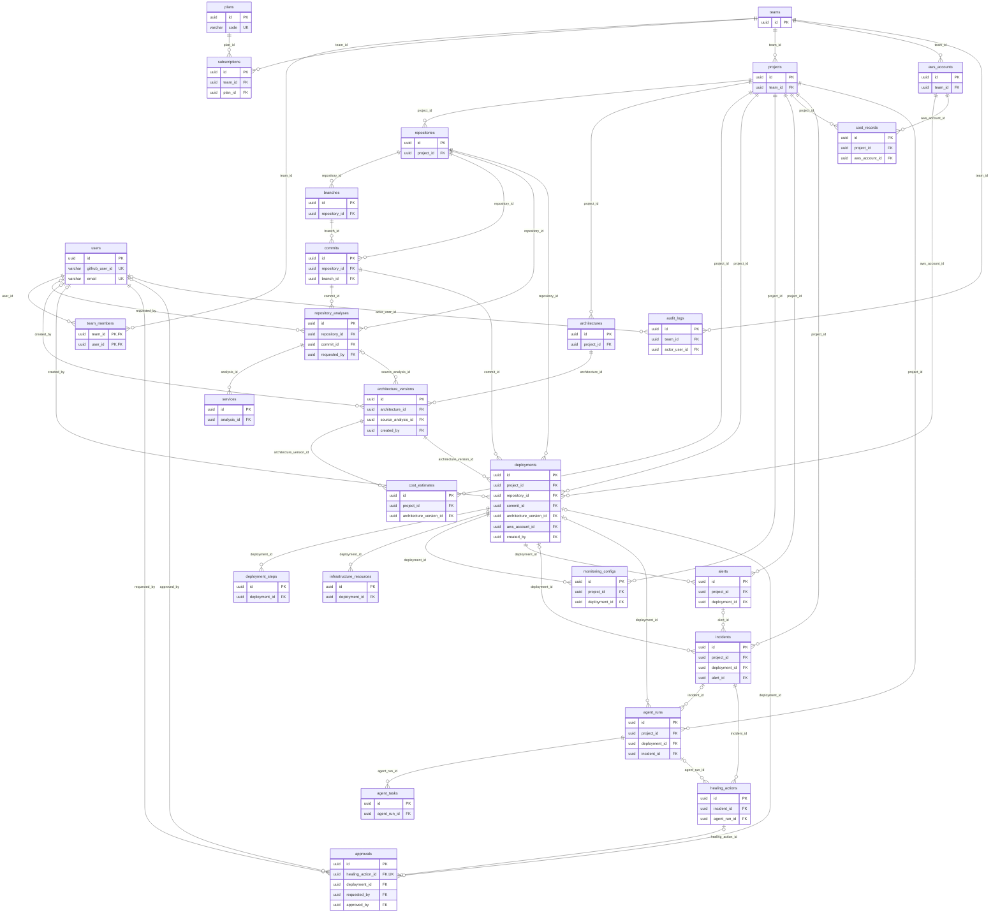

## 2. Identity

Tables: `users`, `teams`, `team_members`

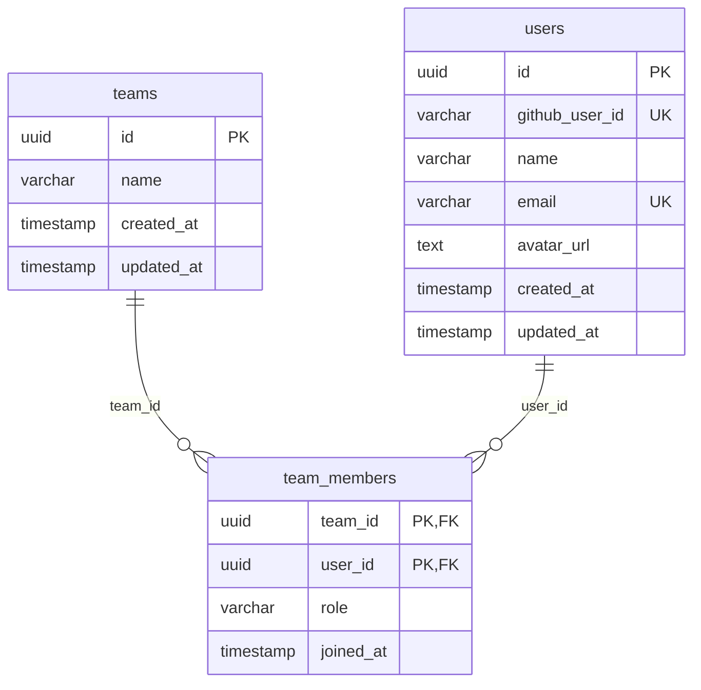

## 3. Subscription

Tables: `plans`, `subscriptions` · context: `teams`

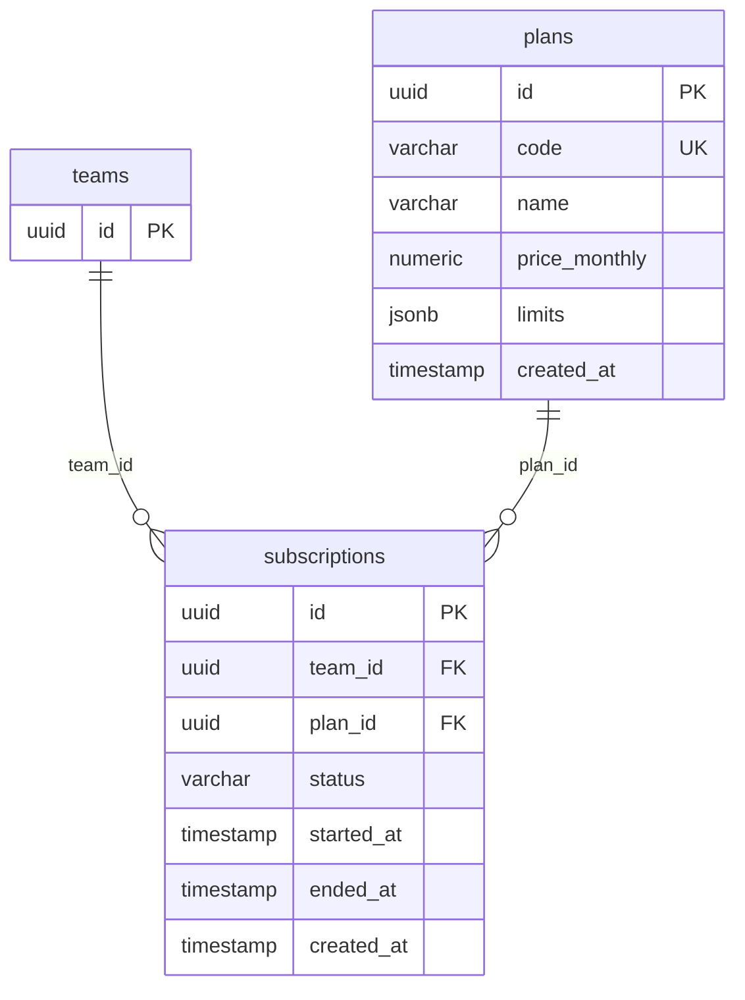

## 4. Project

Tables: `projects` · context: `teams`

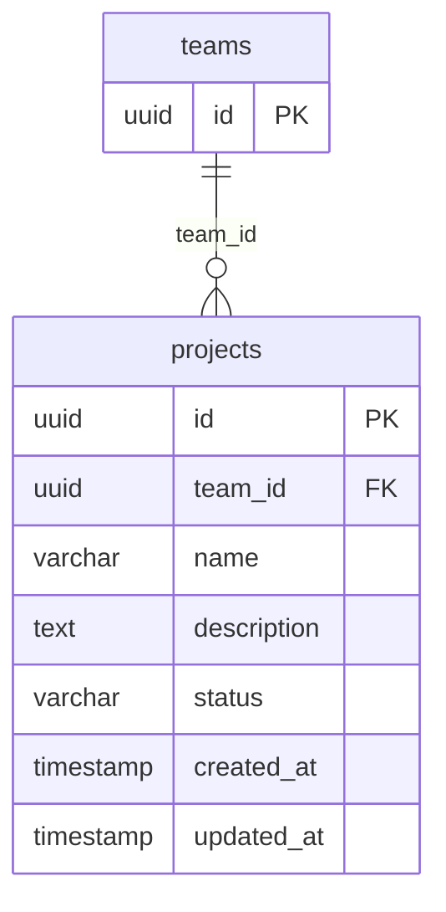

## 5. Source Control

Tables: `repositories`, `branches`, `commits` · context: `projects`

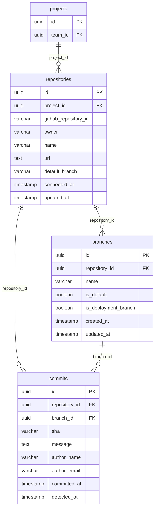

## 6. Analysis

Tables: `repository_analyses`, `services` · context: `repositories`, `commits`, `users`

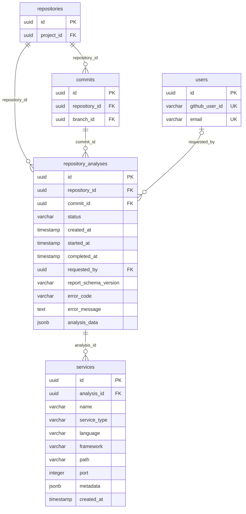

## 7. Architecture

Tables: `architectures`, `architecture_versions` · context: `projects`, `repository_analyses`, `users`

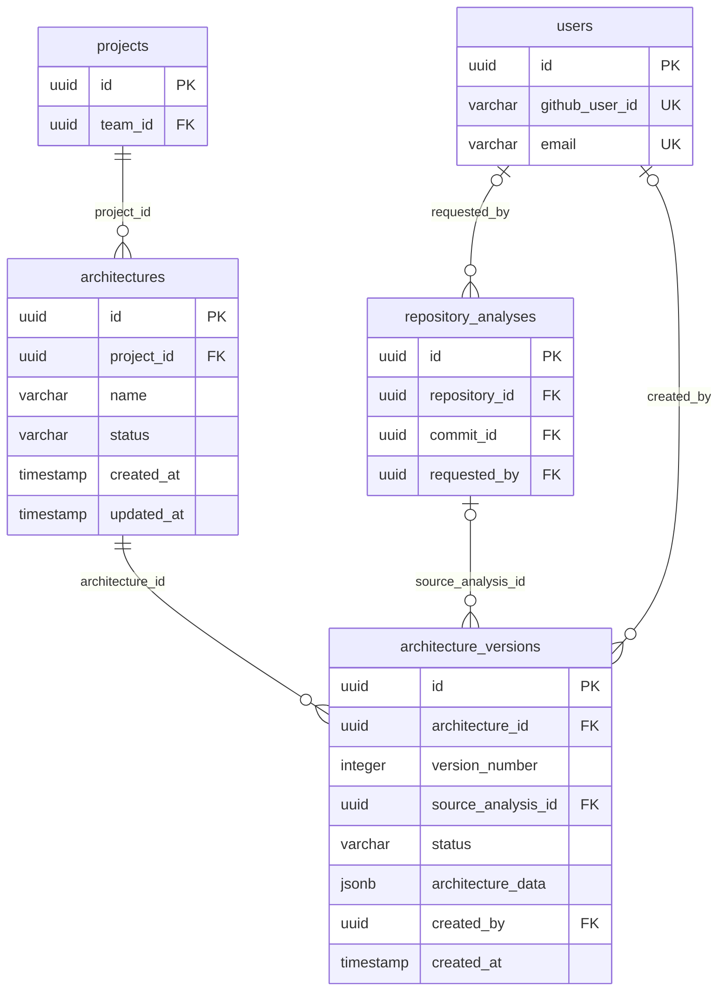

## 8. Cost

Tables: `cost_estimates`, `cost_records` · context: `projects`, `architecture_versions`, `aws_accounts`

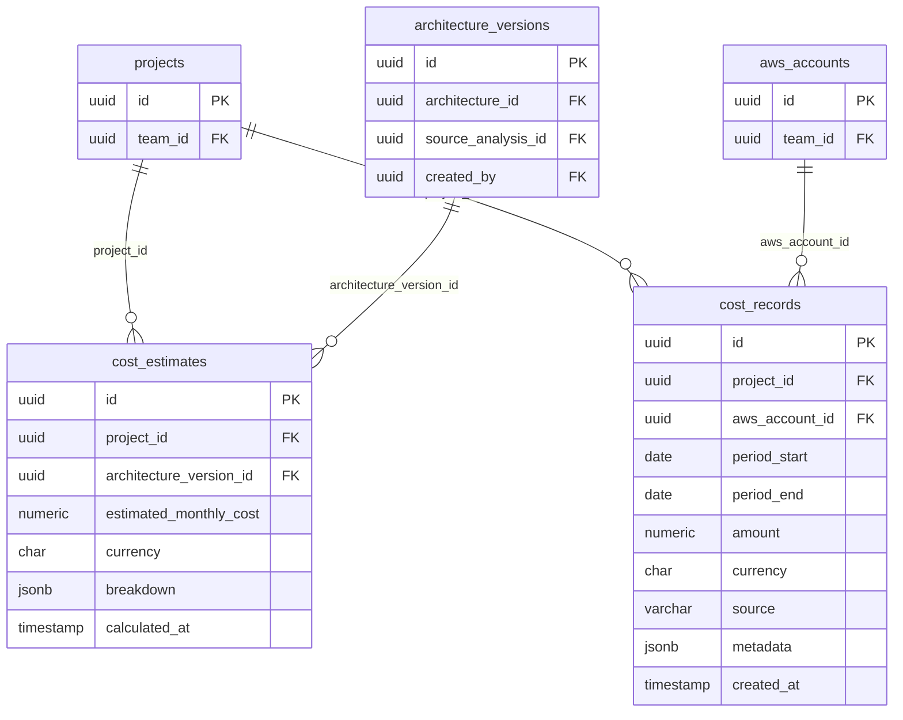

## 9. AWS

Tables: `aws_accounts` · context: `teams`

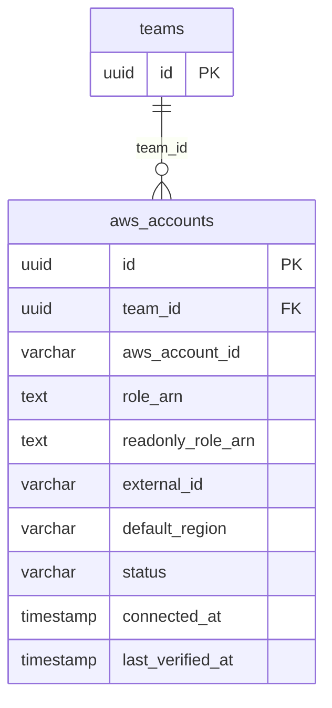

## 10. Deployment

Tables: `deployments`, `deployment_steps`, `infrastructure_resources` · context: `projects`, `repositories`, `commits`, `architecture_versions`, `aws_accounts`, `users`

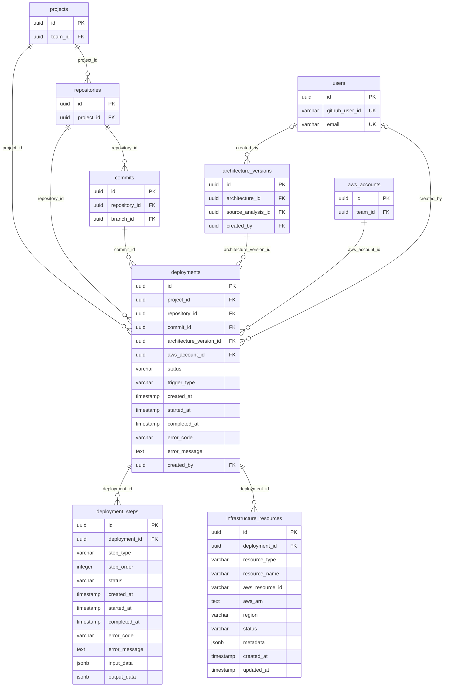

## 11. Monitoring

Tables: `monitoring_configs`, `alerts` · context: `projects`, `deployments`

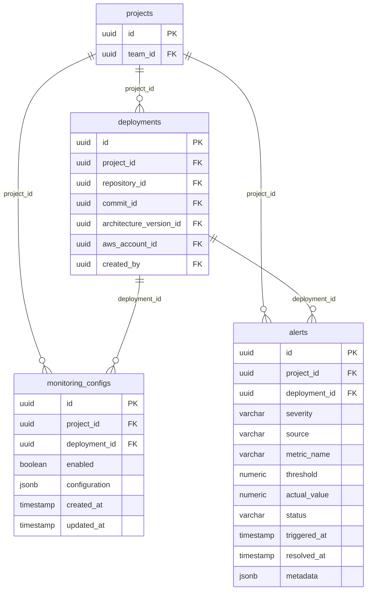

## 12. Incident

Tables: `incidents`, `healing_actions`, `approvals` · context: `projects`, `deployments`, `alerts`, `agent_runs`, `users`

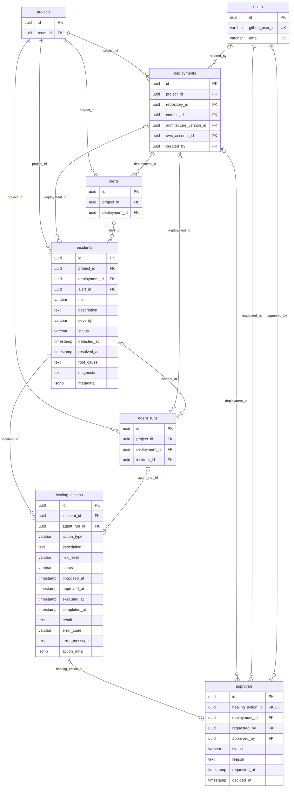

## 13. AI Agents

Tables: `agent_runs`, `agent_tasks` · context: `projects`, `deployments`, `incidents`

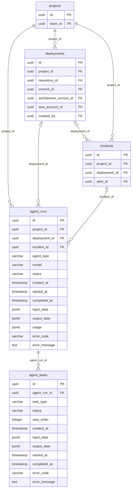

## 14. Audit

Tables: `audit_logs` · context: `teams`, `users`

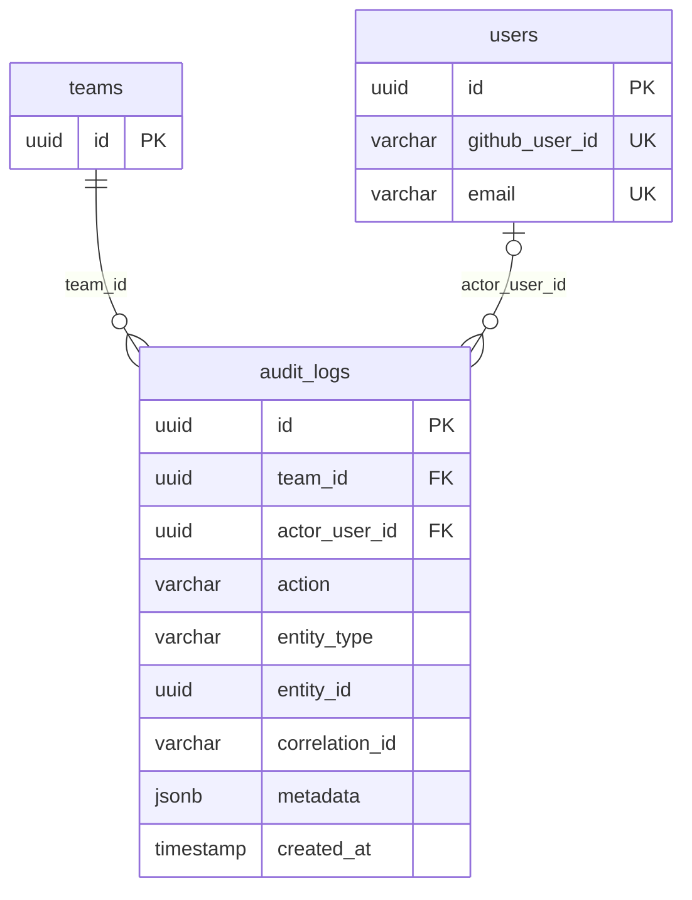

